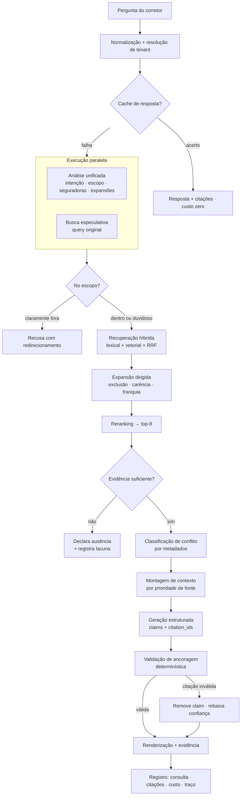
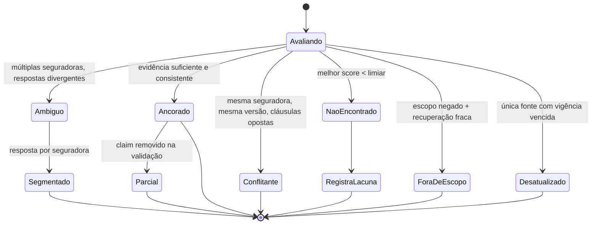
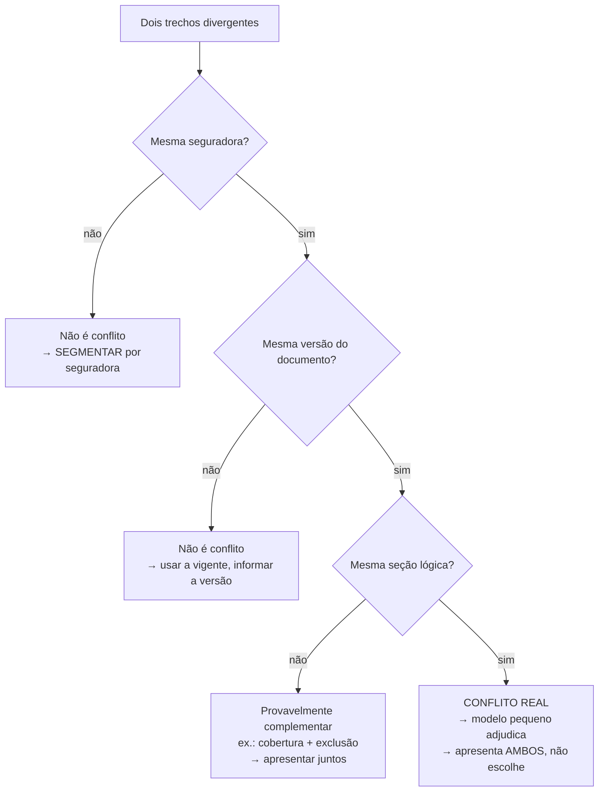
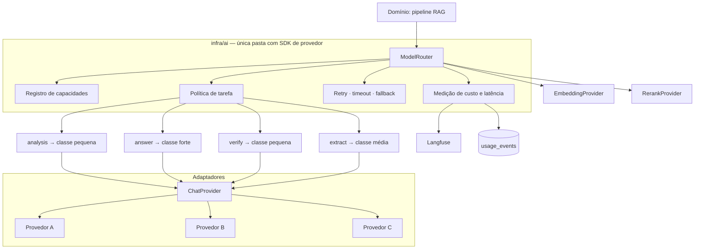

# AI Engine
### Plataforma de Especialistas de IA · Arquitetura de RAG e Governança de Resposta
**Principal AI Engineer · Agosto/2026 · v1.0**

---

## 0. Três correções ao pipeline pedido

O pipeline que você desenhou está conceitualmente certo. Executado literalmente, ele quebra
o requisito de produto.

### 0.1 Doze estágios sequenciais estouram o orçamento de latência

O PRD exige primeira palavra em menos de 3 segundos. Somando os estágios como chamadas
independentes:

```
Intent Detection      280ms
Specialist Context     20ms
Query Rewriting       320ms
Retrieval              80ms
Reranking             200ms
Context Assembly       20ms
LLM (primeiro token)  900ms
                    ───────
                    ~1.820ms   ← cabe, mas sem folga nenhuma
```

Duas chamadas separadas a modelos pequenos (intenção e reescrita) consomem 600ms para
produzir informação que **um único modelo pode devolver junto**.

**Correção 1 — fundir estágios 2 e 4 numa só chamada** que retorna JSON com intenção,
seguradoras mencionadas, tipo de pergunta e as consultas expandidas. Economia: ~300ms e
uma chamada por consulta.

**Correção 2 — recuperação especulativa em paralelo.** Disparar a busca com a pergunta
original ao mesmo tempo que a análise roda. Quando a análise volta, ou os resultados já
servem, ou complementa-se com as consultas expandidas. Economia: mais ~200ms no caminho comum.

```
t=0     ├─ cache lookup (20ms)
        ├─ análise unificada ────────────────┐ (280ms)
        └─ busca especulativa (query bruta) ─┤ (80ms)
t=300              busca complementar (expansões) (80ms)
t=380              reranking (200ms)
t=600              montagem (20ms)
t=620              LLM → primeiro token (900ms)
t≈1.500ms  ✓ com folga real
```

### 0.2 `temperature` não deve ser configurável pelo cliente

Você listou "temperature/configuration" como propriedade do especialista. Para respostas
ancoradas em documento, **temperatura acima de ~0,2 é sempre errada** — ela aumenta variação
de formulação sem aumentar qualidade, e piora reprodutibilidade em auditoria.

Expor esse controle a uma corretora convida a configuração que degrada o produto e depois
vira reclamação. **Decisão:** temperatura é constante por tarefa, definida por engenharia,
não pelo cliente. O que o cliente configura é tom e nível de detalhe.

### 0.3 "Personality" é passivo em produto regulado

Um especialista configurado como "confiante e assertivo" produz **respostas erradas em tom
confiante** — o pior desfecho possível quando um corretor está orientando um cliente.

**Decisão:** personalidade controla apenas registro linguístico (formal / direto / didático).
**Nunca** afeta hedge, grau de certeza ou linguagem de confiança. A expressão de incerteza é
determinada pelo estado de evidência calculado pelo sistema, não pelo tom escolhido pelo
cliente. Isso é uma invariante do motor, não uma configuração.

---

## 1. Configuração do especialista

```yaml
specialist:
  identity:
    name: "Especialista em Seguro Residencial"
    description: "Dúvidas técnicas de apólices residenciais"

  scope:
    branch: residencial
    insurers: [porto, mapfre, tokio]
    in_scope:
      - coberturas, exclusões, carências, franquias
      - procedimentos de sinistro e endosso
      - comparação técnica entre seguradoras do escopo
    out_of_scope:
      - cálculo de prêmio ou cotação
      - recomendação de produto ao cliente final
      - assessoria jurídica
      - ramos fora de `branch`
    out_of_scope_behavior: decline_and_redirect

  personality:
    register: direct          # formal | direct | didactic
    detail_level: concise     # concise | balanced | thorough
    language: pt-BR
    # NÃO influencia expressão de certeza — invariante do motor

  rules:                      # regras da organização, em linguagem natural
    - "Sempre mencionar carência quando a pergunta envolver cobertura"
    - "Nunca sugerir seguradora fora da lista da corretora"
    - "Ao comparar, apresentar as seguradoras em ordem alfabética"

  knowledge:
    sources: [public_document, org_document, internal_note]
    priority_order: [internal_note, org_document, public_document]
    version_policy: current_only     # current_only | include_superseded
    expired_source_policy: answer_with_warning

  model:                      # definido por engenharia, não pelo cliente
    profile: balanced         # fast | balanced | maximum
    # profile → mapeia para classes de modelo por tarefa (seção 5)

  response:
    format: structured_claims
    max_answer_tokens: 600
    lead_with: exclusion_first
    require_citation_for_factual_claims: true

  citation_policy:
    min_citations: 1
    max_citations: 6
    verify_spans: true
    on_unverifiable_citation: drop_and_downgrade

  safety:
    prohibited_outputs:
      - afirmar cobertura sem citação verificada
      - orientar a acionar ou não acionar sinistro
      - informar preço, prêmio ou valor de indenização
      - interpretação jurídica além do texto da cláusula
      - conteúdo que substitua parecer técnico do corretor
    injection_defense: strict
    pii_handling: no_echo

  fallback:
    insufficient_evidence: declare_and_register_gap
    provider_unavailable: secondary_provider
    all_providers_unavailable: cache_only_with_notice
    reranker_unavailable: proceed_with_rrf
    degraded_notice: visible
```

**Onde essa configuração vive:** `specialists.config` (JSONB) no modelo de dados, congelada
em `specialist_versions.config_snapshot` a cada publicação. Toda resposta registra qual versão
de configuração a produziu — sem isso, não há como diagnosticar regressão de qualidade.

---

## 2. Pipeline



### 2.1 Especificação por estágio

| # | Estágio | Entrada | Saída | Modelo | Orçamento |
|---|---|---|---|---|---|
| 1 | **Normalização** | Texto bruto | Texto normalizado + `cache_key` | — | 20ms |
| 2 | **Cache** | `cache_key` | Resposta ou falha | — | 15ms |
| 3 | **Análise unificada** | Pergunta + escopo do especialista | JSON estruturado | Pequeno | 280ms |
| 4 | **Recuperação** | Consultas | Top-50 candidatos | — | 80ms |
| 5 | **Expansão dirigida** | Produto + cobertura identificada | Chunks de exclusão/carência | — | 60ms |
| 6 | **Reranking** | Top-50 + pergunta | Top-8 pontuados | Reranker | 200ms |
| 7 | **Suficiência** | Scores + limiares | Decisão | — | 5ms |
| 8 | **Classificação de conflito** | Metadados dos chunks | Tipo de divergência | Regras + modelo pequeno* | 0–250ms |
| 9 | **Montagem** | Top-8 + configuração | Prompt estruturado | — | 20ms |
| 10 | **Geração** | Prompt | Claims + citações | Forte | 900ms/token 1 |
| 11 | **Validação de ancoragem** | Claims + chunks | Claims verificados | — | 30ms |
| 12 | **Registro** | Tudo | Persistência + traço | — | assíncrono |

\* O modelo só é chamado no estágio 8 quando as regras de metadados não resolvem — o que é
minoria dos casos (ver 3.4).

### 2.2 Saída da análise unificada (estágio 3)

```json
{
  "intent": "coverage_check",
  "intent_confidence": 0.94,
  "in_scope": true,
  "insurers_mentioned": ["porto"],
  "insurer_ambiguous": false,
  "product_hint": "residencial",
  "risk_terms": ["vazamento", "telhado"],
  "requires_exclusion_lookup": true,
  "expanded_queries": [
    "cobertura danos por água vazamento telhado",
    "exclusões danos por água infiltração",
    "carência danos elétricos e hidráulicos"
  ],
  "comparative": false
}
```

Intenções reconhecidas: `coverage_check` · `exclusion_check` · `waiting_period` ·
`claim_procedure` · `comparison` · `definition` · `internal_procedure` · `out_of_scope` ·
`meta` (pergunta sobre a ferramenta).

`requires_exclusion_lookup` é o campo mais importante do JSON. Ele dispara a regra que evita
o modo de falha que mata o produto — responder "sim, cobre" sem ter olhado a exclusão.

### 2.3 Montagem de contexto (estágio 9)

**Prioridade de fonte** quando há competição por espaço:

```
1. internal_note   (conhecimento da corretora — vence sempre)
2. org_document    (procedimento interno, manual da corretora)
3. public_document (Condições Gerais)
```

Isso implementa o princípio do PRD: **o conhecimento da organização tem precedência sobre o
conhecimento geral e sobre o documento público.** Se a nota interna disser "não trabalhamos
com imóveis em área de alagamento", isso prevalece sobre o que a CG permite.

**Estrutura do contexto entregue ao modelo:**

```
[INSTRUÇÕES DO SISTEMA]           ← única região com autoridade

[CONFIGURAÇÃO DO ESPECIALISTA]    ← escopo, regras, tom

[EVIDÊNCIA RECUPERADA]            ← delimitada, marcada como DADO
  <evidence id="c1" source="CG Porto Residencial" version="4"
            clause="4.2.1" page="38" kind="coverage" priority="public">
    ...texto da cláusula...
  </evidence>
  <evidence id="c2" ... kind="exclusion" ...>
  <evidence id="c3" ... priority="internal">

[PERGUNTA DO USUÁRIO]             ← delimitada, marcada como DADO
```

> **Regra estrutural de segurança:** conteúdo recuperado **nunca** entra na região de
> instruções do sistema. Ele entra em blocos delimitados, explicitamente rotulados como
> dado a ser citado, jamais obedecido. Ver seção 4.8.

### 2.4 Formato de saída — a decisão que torna a validação determinística

O modelo não devolve prosa livre. Devolve estrutura:

```json
{
  "answer_summary": "Sim, com ressalva importante sobre manutenção.",
  "claims": [
    {
      "text": "Vazamentos por ruptura da tubulação são cobertos.",
      "citation_ids": ["c1"],
      "certainty": "explicit"
    },
    {
      "text": "Infiltração por falta de manutenção do telhado está excluída.",
      "citation_ids": ["c2"],
      "certainty": "explicit"
    }
  ],
  "unsupported_notes": [],
  "evidence_state": "grounded",
  "insurer_scope": ["porto"]
}
```

**Por que isso importa:** cada afirmação carrega seus `citation_ids`. A validação do estágio 11
é então uma verificação determinística — os ids existem? o trecho citado contém o suporte? —
e não uma avaliação subjetiva de "a resposta parece ancorada?". Prosa livre torna a
verificação impossível e obriga a confiar no modelo, que é exatamente o que não se pode fazer.

`certainty` é `explicit` (o texto afirma), `inferred` (segue do texto) ou `absent`.
Claim com `certainty: absent` é rejeitado antes de chegar ao usuário.

### 2.5 Validação de ancoragem (estágio 11)

Três verificações, todas determinísticas:

1. **Existência:** todo `citation_id` está no conjunto recuperado? Id inventado → claim removido.
2. **Suporte léxico:** há sobreposição de termos significativos entre o claim e o trecho citado?
   Abaixo do limiar → claim marcado para verificação.
3. **Verificação de implicação** (apenas para claims marcados, apenas quando o estado é
   `grounded`): chamada a modelo pequeno perguntando se o trecho sustenta a afirmação.
   Custo controlado porque atinge minoria dos claims.

**Resultado:** se qualquer claim for removido, o estado de evidência é rebaixado de `grounded`
para `partial`, e a interface muda o tratamento visual. O sistema **nunca** entrega uma
afirmação sem lastro — ele prefere entregar menos.

---

## 3. Máquina de estados de evidência



Sete estados internos, **três tratamentos visuais** (conforme a spec de UX): ancorado ·
atenção (parcial, conflitante, desatualizado, ambíguo) · não encontrado.

---

## 4. Políticas de tratamento

### 4.1 Perguntas ambíguas

Existem duas ambiguidades diferentes e elas se tratam de formas opostas:

| Tipo | Exemplo | Tratamento |
|---|---|---|
| **Ambiguidade de seguradora** | "Cobre vazamento?" com 3 seguradoras no escopo | **Não perguntar. Segmentar.** |
| **Ambiguidade semântica** | "Cobre o carro?" num especialista residencial | Perguntar, com opções |

**Por que não perguntar na ambiguidade de seguradora:** Marina está com o cliente na linha.
Cada pergunta de volta é 15 segundos e uma quebra de fluxo. Se as três respostas são iguais,
responde-se uma vez e lista-se as três. Se divergem, apresenta-se segmentado:

```
Porto ......... coberto, com carência de 30 dias
MAPFRE ........ coberto, sem carência
Tokio Marine .. excluído quando decorrente de falta de manutenção
```

**Exceção:** se a resposta segmentada passar de ~4 seguradoras ou ficar longa demais para
leitura rápida, aí sim aparecem os chips de escolha. A regra é *segmentar por padrão,
perguntar por exceção*.

### 4.2 Perguntas fora do escopo

O erro comum é um classificador rígido que bloqueia pergunta legítima e ensina o usuário a
não confiar na ferramenta. **Recusar por escopo é o único caminho sem volta do pipeline** —
merece cautela.

**Portão suave, em duas condições:**

```
Recusa por escopo SE:
    classificador diz fora do escopo (confiança > 0,85)
  E a recuperação também não trouxe nada relevante

Se o classificador diz "fora" mas a recuperação achou evidência forte
  → responde mesmo assim, e registra a divergência para calibração
```

Um classificador que discorda da evidência está provavelmente errado — a evidência é o sinal
mais confiável dos dois.

Recusa sempre nomeia o que o especialista cobre e oferece o caminho ("Isso é de auto, e este
especialista é de residencial. Quer enviar como sugestão ao administrador?").

### 4.3 Ausência de informação

```
melhor_score_pós_rerank < limiar_absoluto     → não encontrado
OU
(melhor_score < limiar_relativo E não há chunk de nota interna)  → não encontrado
```

**Nunca chamar o modelo forte neste caminho.** Recusar é mais barato, mais rápido e mais
correto que gerar e torcer.

A recusa é específica, não genérica: informa o que foi consultado ("Procurei nas Condições
Gerais das três seguradoras e nos documentos da corretora"), o que não foi encontrado, e
oferece "Pedir para o time" — que registra a lacuna e alimenta a jornada J4.

**Calibração:** os limiares são derivados do golden set, não escolhidos por intuição.
A meta operacional é 10–20% de recusas. Perto de zero significa que o sistema está inventando.

### 4.4 Documentos conflitantes — classificar antes de julgar

Erro comum: perguntar ao modelo "há conflito aqui?". Ele responde com confiança inventada.
A maior parte dos "conflitos" não é conflito — é metadado.



Só o ramo final chega ao modelo. Os outros três — que são a maioria — são resolvidos por
metadados, de graça e sem chance de erro.

**No conflito real, o sistema não escolhe.** Mostra os dois trechos lado a lado, marca o
estado como `conflicting` e sinaliza para revisão do administrador. Escolher um lado sem
base é assumir uma responsabilidade que é do corretor.

### 4.5 Documentos desatualizados

| Situação | Comportamento |
|---|---|
| Existe versão vigente | Usa só ela. Versões anteriores não entram na recuperação |
| Única fonte tem vigência vencida | Responde, com aviso destacado, e informa a data de validade |
| Vigente e vencida discordam | Trata como divergência de versão (4.4), usa a vigente e informa |

**Toda resposta carrega a versão utilizada.** É requisito de auditoria, não cortesia — a
citação guarda o rótulo da versão no snapshot imutável do banco.

### 4.6 Múltiplas seguradoras e comparação

Pergunta comparativa detectada (`intent: comparison`) muda o pipeline: recuperação
**por seguradora, em paralelo**, com orçamento de contexto reservado para cada uma.

Sem isso, o reranking global favorece a seguradora cujo documento é mais bem escrito, e a
comparação sai enviesada — a seguradora com CG confusa parece ter cobertura pior. É um viés
sutil e caro: o corretor toma decisão comercial com base nele.

**Restrições da resposta comparativa:**
- Toda seguradora citada precisa de citação própria; sem evidência, escreve-se "não localizado"
- Ordem definida pela regra da organização (padrão: alfabética), nunca por "qualidade"
- **O sistema não declara vencedora.** Apresenta as diferenças; a recomendação é do corretor.
  Recomendar produto está na lista de saídas proibidas.

### 4.7 Tentativa de burlar as regras

Vetores esperados: pedir para ignorar instruções, pedir para "fingir que é outro assistente",
pedir opinião jurídica, pedir cotação, tentar extrair o prompt do sistema, tentar acessar
documento de outra corretora.

**Defesas, em camadas — a última é a que sustenta tudo:**

1. Instrução do sistema é imutável e não referencia conteúdo do usuário
2. Configuração do cliente entra como dado estruturado, nunca concatenada em texto livre
3. Escopo é avaliado no estágio 3, antes de qualquer geração
4. **Toda afirmação factual exige citação verificada** — mesmo que uma tentativa consiga
   alterar o tom ou o comportamento, ela não consegue fabricar uma citação que sobreviva
   à validação determinística do estágio 11
5. Isolamento de tenant é do banco (RLS + FK composta), não do prompt — nenhuma instrução
   textual alcança dados de outra organização
6. Tentativas detectadas são registradas em auditoria

> A camada 4 é a defesa estrutural: **o pior resultado de uma injeção bem-sucedida é uma
> resposta sem claims**, porque nada passa sem lastro verificável.

### 4.8 Injeção via documento

Este é o vetor sério, e vale distinguir a origem:

| Origem | Confiança | Risco |
|---|---|---|
| Nota interna escrita pelo sócio | Alta | Baixo |
| Documento enviado pela corretora | Média | Médio — pode ter vindo de terceiro |
| CG pública baixada de fonte externa | **Baixa** | **Alto — o conteúdo não é controlado por ninguém do sistema** |

**Defesas em duas fases:**

*Na ingestão:*
- Varredura por padrões imperativos dirigidos a modelo ("ignore as instruções", "você é
  agora...", "não cite a fonte")
- Detecção de texto oculto: fonte de tamanho zero, texto branco sobre branco, camadas
  invisíveis, metadados suspeitos
- Chunk marcado como suspeito é **excluído da indexação** e sinalizado ao administrador
- O documento entra como "Pronto com ressalvas" com a página apontada

*Na consulta:*
- Conteúdo recuperado sempre em bloco delimitado com rótulo explícito de dado
- Instrução do sistema declara que texto dentro dos blocos de evidência é material a citar,
  nunca comando a executar
- Delimitadores gerados por requisição, impedindo que um documento os feche antecipadamente
- **A validação de ancoragem fecha o ciclo:** uma instrução injetada não produz citação
  válida, então não produz claim entregável

### 4.9 Respostas potencialmente perigosas

Neste produto, "perigoso" não é toxicidade. É **dano financeiro e jurídico ao segurado e à
corretora**. Cinco classes proibidas:

| Classe | Por quê |
|---|---|
| Afirmar cobertura sem citação verificada | É a causa raiz de sinistro negado |
| Orientar a acionar ou não acionar sinistro | Decisão do corretor com o cliente, não da ferramenta |
| Informar preço, prêmio ou valor de indenização | Fora do escopo do MVP e depende de subscrição |
| Interpretação jurídica além do texto da cláusula | Corretora não é escritório de advocacia |
| Substituir o parecer técnico do corretor | Destrói o posicionamento de "leitura assistida" |

Aplicadas na instrução do sistema **e** verificadas na saída estruturada — instrução sozinha
não é controle, é pedido.

---

## 5. Abstração de modelos



### 5.1 O contrato

O erro comum é abstrair só a chamada. O que precisa ser abstraído é a **capacidade**, porque
os provedores diferem em coisas que quebram o pipeline em silêncio:

```
capabilities:
  structured_output: native | json_mode | prompt_only
  streaming: bool
  max_context_tokens: int
  supports_system_role: bool
  vision: bool
  cost_per_1k_input / cost_per_1k_output
```

`structured_output` é o campo crítico. O estágio 10 depende de JSON confiável. Provedor com
saída estruturada nativa é uma coisa; provedor onde se pede JSON no prompt e torce é outra.
O adaptador declara sua capacidade e o roteador **compensa** — validando e repetindo com
correção onde necessário — em vez de o pipeline quebrar em produção.

### 5.2 Perfis de tarefa

| Tarefa | Classe | Temperatura | Por quê |
|---|---|---|---|
| `analysis` | Pequena e rápida | 0,0 | Classificação; volume alto |
| `answer` | Forte | 0,1 | É o produto |
| `verify` | Pequena | 0,0 | Verificação de implicação, minoria dos claims |
| `extract` | Média | 0,0 | Metadados na ingestão; assíncrono |
| `adjudicate` | Pequena | 0,0 | Conflito real, caso raro |

O cliente escolhe `profile: fast | balanced | maximum`, que remapeia as classes. Ele nunca
escolhe modelo nem temperatura — escolhe um ponto na curva custo/qualidade.

### 5.3 Três trocas com dificuldades muito diferentes

| Troca | Esforço | Procedimento |
|---|---|---|
| **Modelo de chat** | Minutos | Alterar política → rodar golden set → comparar acerto, latência e custo → virar |
| **Reranker** | Horas | Novo adaptador → **recalibrar limiares de suficiência** (scores não são comparáveis entre modelos) → validar taxa de recusa |
| **Embeddings** | Dias | Nova linha em `chunk_embeddings` com outro `model` → reindexar em paralelo → comparar → virar por organização → descartar o antigo |

**A armadilha do reranker** é a que passa despercebida: trocar o modelo muda a escala dos
scores, e os limiares de suficiência calibrados para o anterior deixam de valer. O sintoma é
o sistema virar excessivamente recusador — ou, pior, parar de recusar. Recalibração contra o
golden set não é opcional nessa troca.

### 5.4 Fallback

```
Provedor primário (timeout 8s)
  → falha → Provedor secundário (outro fornecedor, não outro modelo do mesmo)
    → falha → resposta do cache, se houver
      → falha → indisponibilidade honesta, sem resposta degradada
```

Fallback entre modelos do **mesmo fornecedor** não protege contra o modo de falha mais comum,
que é indisponibilidade da plataforma inteira. O secundário precisa ser de outra empresa.

**Nunca** degradar silenciosamente para um modelo pior: se o secundário assumir, a resposta
carrega marcação interna e o traço registra. Qualidade que muda sem ninguém saber é
impossível de diagnosticar depois.

---

## 6. Avaliação — o que sustenta tudo acima

Nenhuma decisão deste documento é verificável sem isto.

**Golden set:** 100 perguntas reais de corretor, cada uma com resposta esperada e **a cláusula
que a sustenta**.

**Conjuntos de controle, tão importantes quanto:**

| Conjunto | Tamanho | O que mede | Meta |
|---|---|---|---|
| Golden set | 100 | Recuperou a cláusula certa? | ≥85% |
| Sem resposta | 20 | Perguntas cuja resposta não está no acervo | 100% de recusa, 0 invenção |
| Exclusões | 25 | "Cobre X?" com exclusão aplicável | 100% exibem a exclusão |
| Fora de escopo | 15 | Perguntas de outro ramo | Recusa correta, sem falso positivo |
| Adversarial | 15 | Tentativas de injeção e de burla | 0 claims sem lastro |
| Ambiguidade | 10 | Sem seguradora especificada | Segmenta corretamente |

**Métricas por estágio, não só ponta a ponta.** Quando o acerto cai, é preciso saber se foi
recuperação, reranking ou geração:

```
recall@50 (recuperação)  ·  recall@8 (pós-reranking)  ·  MRR
taxa de ancoragem  ·  claims removidos na validação
taxa de recusa  ·  falsa recusa  ·  latência p50/p95  ·  custo/consulta
```

**Regra operacional:** nenhuma mudança de prompt, modelo, chunking ou limiar entra em
produção sem rodar contra os seis conjuntos. Sem isso, cada ajuste é uma aposta, e ajustes
de RAG são notórios por melhorar um caso e quebrar três.

**E a métrica que eu vigiaria mais de perto:** *recall do golden set segmentado por tamanho
de organização*. É onde o problema de HNSW filtrado por tenant (P1 do modelo de dados) se
manifesta — funciona com um cliente e degrada em silêncio quando entra o décimo.

---

## 7. Resumo das invariantes do motor

Coisas que **nenhuma configuração de cliente pode alterar**:

1. Toda afirmação factual exige citação verificada
2. Temperatura para resposta é fixa e baixa
3. Personalidade nunca afeta expressão de certeza
4. Sem evidência suficiente, declara ausência — não gera
5. Conflito real é exibido, nunca resolvido pelo sistema
6. Conteúdo recuperado é dado, jamais instrução
7. Versão da fonte utilizada consta em toda resposta
8. Isolamento de tenant é do banco, não do prompt
9. Recomendação de produto e informação de preço são proibidas
10. Degradação de qualidade é sempre registrada e visível

---

**Próximo passo sugerido:** especificação do pipeline de avaliação e a coleta do golden set
com a corretora parceira. É a única coisa entre este documento e saber se ele funciona.
