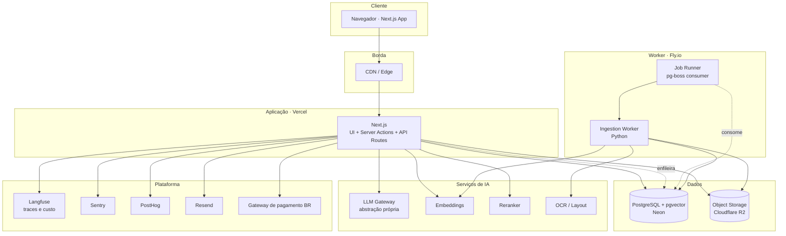
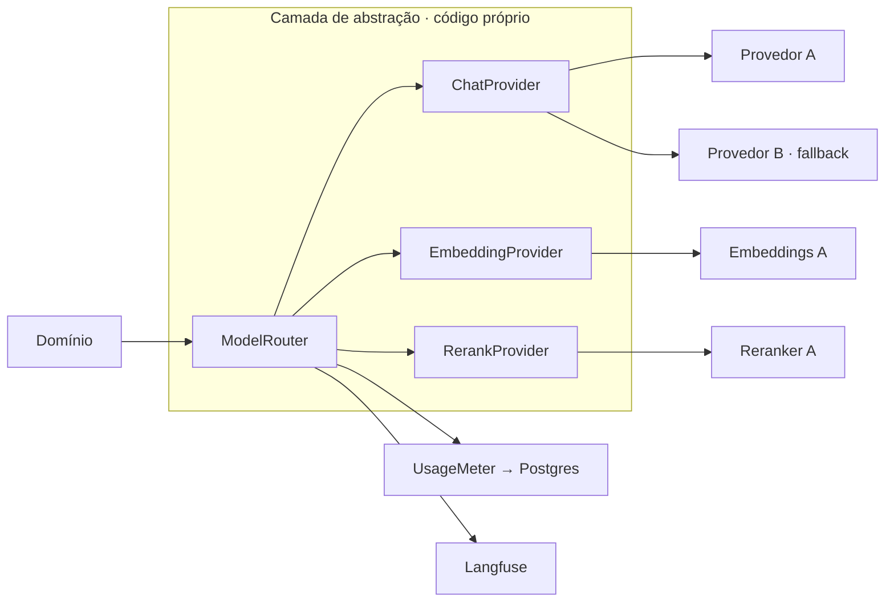
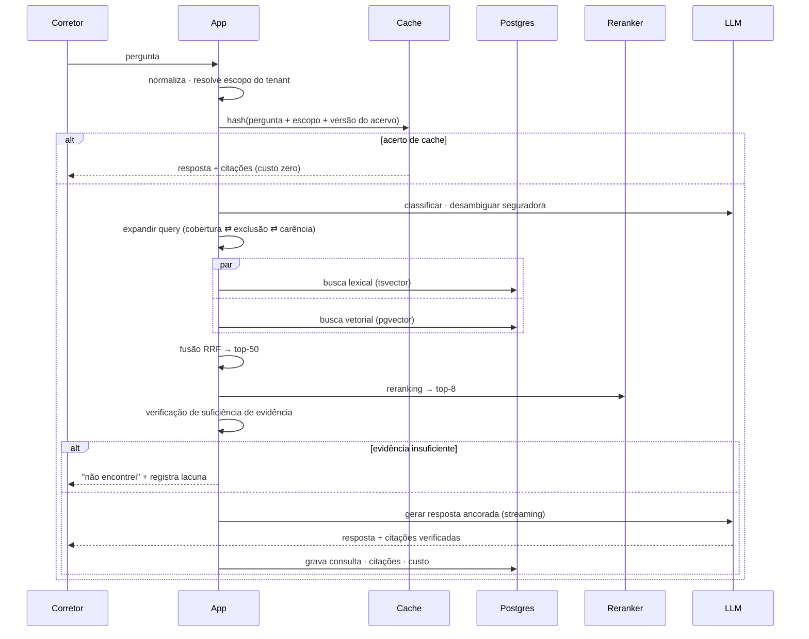
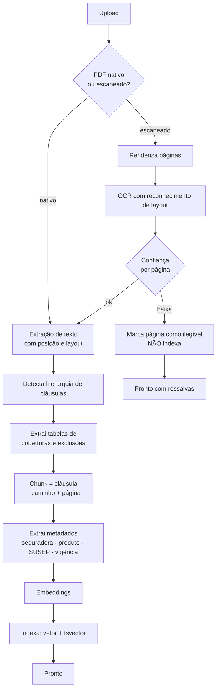
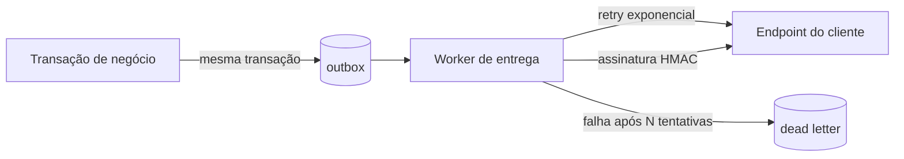
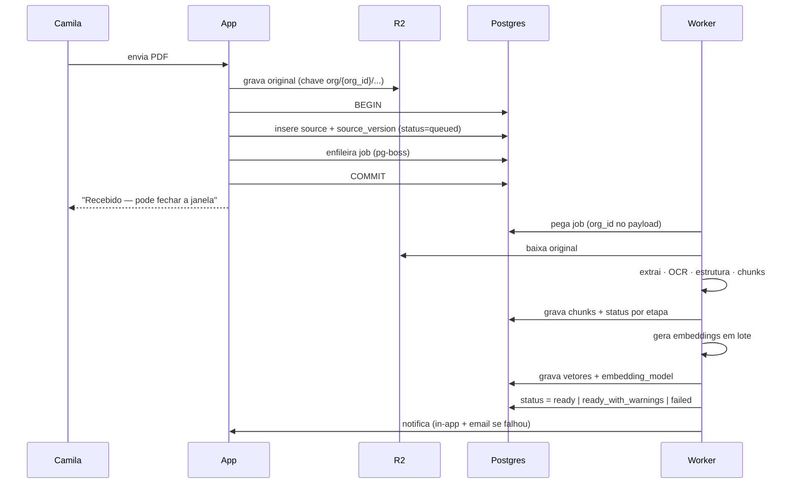
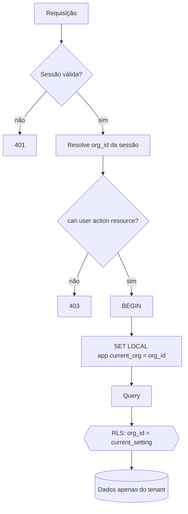

# Arquitetura Técnica
### Plataforma de Especialistas de IA · Vertical Seguros
**Principal Software Architect · Agosto/2026 · v1.0**

---

## 0. Restrições que determinam toda a arquitetura

Arquitetura não se escolhe no vácuo. Estas cinco restrições eliminam a maior parte das
opções antes da primeira avaliação:

| # | Restrição | Consequência arquitetural |
|---|---|---|
| C1 | **Um desenvolvedor**, que também vende e dá suporte | Cada serviço adicional é custo permanente de atenção. Monolito, não microserviços |
| C2 | **Ticket de R$ 350–600/mês** | Piso de infraestrutura precisa ficar abaixo de ~US$ 250/mês nos primeiros 20 clientes |
| C3 | **Volume real modesto** — ~200 consultas/corretora/mês | Elimina toda tecnologia justificada por escala que não existe |
| C4 | **Qualidade de extração documental é o produto** | Vale gastar complexidade aqui e economizar em todo o resto |
| C5 | **LGPD + setor regulado** | Isolamento verificável, trilha de auditoria, DPA com processadores, transparência sobre o que sai do país |

> **Princípio que aplico em todas as decisões abaixo:** gastar a complexidade disponível na
> camada que diferencia (ingestão e recuperação) e ser deliberadamente entediante em todo o resto.

---

## 1. Visão geral do sistema



**Três processos, não trinta.** Aplicação web, worker de ingestão e banco. Tudo o mais é
serviço gerenciado de terceiro.

---

## 2. Componentes e responsabilidades

| Componente | Responsabilidade | Não é responsável por |
|---|---|---|
| **Next.js App** | UI, autenticação, autorização, orquestração de consulta, streaming de resposta, admin | Processar documentos, tarefas longas |
| **Ingestion Worker (Python)** | Extração, OCR, segmentação por cláusula, embeddings, indexação | Servir requisições de usuário |
| **PostgreSQL** | Estado, vetores, busca lexical, fila, eventos de uso, auditoria | Armazenar binários |
| **R2** | PDFs originais, páginas renderizadas, exportações | Metadados |
| **LLM Gateway (código próprio)** | Roteamento de modelo, retry, fallback, contabilização de custo | Regra de negócio |
| **Langfuse** | Traço de cada consulta, custo, latência, avaliação | Cobrança (fonte da verdade é o Postgres) |

---

## 3. Avaliação de stack

Formato: opções reais consideradas → decisão → por quê.

### 3.1 Frontend

| Opção | Prós | Contras |
|---|---|---|
| **Next.js (App Router) + TypeScript** | Um repositório, SSR para admin, streaming nativo, ecossistema | Acoplamento a padrões da Vercel |
| Remix / React Router | Excelentes primitivas de dados | Ecossistema menor de IA |
| SPA + API separada | Separação limpa | Dois deploys, dois contratos, para um dev |

**Decisão: Next.js + TypeScript + Tailwind + shadcn/ui.**
Streaming de resposta é requisito de produto (primeira palavra em <3s) e o App Router
resolve isso nativamente. shadcn/ui dá componentes acessíveis sem virar dependência de
biblioteca — o código fica no repositório.

### 3.2 Backend

| Opção | Avaliação |
|---|---|
| **Monolito modular no Next.js** | ✅ Um deploy, um modelo de tipos ponta a ponta |
| NestJS separado | Estrutura melhor em time grande; overhead puro para uma pessoa |
| Microserviços | ❌ Não há domínio nem time que justifique |

**Decisão: monolito modular.** Módulos com fronteiras explícitas (`knowledge`, `retrieval`,
`identity`, `billing`, `usage`), comunicando por interfaces internas. **A modularidade é
disciplina de código, não topologia de rede** — permite extrair um módulo depois sem pagar
o custo distribuído agora.

**Exceção deliberada:** o worker de ingestão é um processo separado, em Python. Ver ADR-004.

### 3.3 Banco de dados

| Opção | Avaliação |
|---|---|
| **PostgreSQL (Neon)** | ✅ RLS, pgvector, full-text em português, fila, JSONB — tudo em um lugar |
| Supabase | Ótimo pacote, mas traz auth e storage que eu não quero acoplar |
| MySQL/PlanetScale | Sem vetores nativos, sem RLS |
| MongoDB | ❌ Dados fortemente relacionais e transacionais |

**Decisão: PostgreSQL gerenciado com pgvector.**
Neon por branching de banco (útil para testar migração de esquema sozinho) e escala a zero
em ambientes de desenvolvimento.

### 3.4 Vector Database — **a decisão mais contraintuitiva**

Contas reais do produto:

```
1.000 documentos × 150 páginas × ~4 cláusulas/página ≈ 600.000 chunks
600.000 × 1.024 dimensões × 4 bytes ≈ 2,4 GB de vetores
```

| Opção | Custo/mês | Avaliação |
|---|---|---|
| **pgvector (HNSW) no mesmo Postgres** | ~US$ 0 adicional | ✅ Join direto com metadados, uma transação, RLS aplica |
| Pinecone | US$ 70+ | Sistema a mais, sincronização eventual, filtro de tenant fora do banco |
| Qdrant self-hosted | US$ 20 + ops | Melhor em escala real; ops que não tenho |

**Decisão: pgvector, sem banco vetorial dedicado.**

O argumento decisivo não é custo — é **filtro por metadados**. Toda consulta deste produto é
filtrada por organização, seguradora, produto e vigência. Em banco vetorial separado isso é
pré-filtro frágil e sincronização eventual. No Postgres é `WHERE` com índice, na mesma
transação, sob a mesma RLS.

**Gatilho de revisão:** >5 milhões de chunks ou p95 de busca vetorial >300ms.

### 3.5 Object Storage

| Opção | Egress | Avaliação |
|---|---|---|
| **Cloudflare R2** | **Zero** | ✅ O produto serve PDFs o tempo todo — egress é o custo dominante |
| AWS S3 | ~US$ 0,09/GB | Egress vira o maior item da conta |
| Supabase Storage | Limitado | Acoplamento |

**Decisão: R2**, com URLs assinadas de vida curta (5 min) e chave prefixada por organização.

### 3.6 Autenticação

| Opção | Custo | Avaliação |
|---|---|---|
| **Better Auth** (biblioteca, no próprio Postgres) | R$ 0 | ✅ Organizações, convites e papéis nativos; sem custo por usuário |
| Clerk | US$ 25 + por MAU | Mais rápido de subir; custo cresce com o que você vende |
| WorkOS | Grátis até 1M MAU | Ótimo para SSO empresarial — que a corretora não pede |
| Auth próprio do zero | ❌ | Nunca |

**Decisão: Better Auth.** O modelo de negócio é por assento; pagar por MAU a um terceiro
comprime margem exatamente onde ela é apertada. Não é "construir autenticação" — é usar
biblioteca madura sobre o banco que já existe. Sessão em cookie httpOnly, rotação de refresh,
link mágico como opção de entrada.

### 3.7 Autorização

**Decisão: RBAC simples com três papéis** — `owner`, `admin`, `member` — expressos em um
único módulo `authorization` com uma função `can(user, action, resource)`.

CASL, OPA e afins são desproporcionais para três papéis. **A defesa real de multi-tenancy
não é RBAC — é RLS no banco** (ADR-003). RBAC decide *o que* o usuário faz; RLS garante
que ele nunca alcance dados de outra organização, mesmo com bug na aplicação.

### 3.8 Fila

| Opção | Avaliação |
|---|---|
| **pg-boss (Postgres)** | ✅ Zero infra nova, transacional com os dados, retry e agendamento |
| BullMQ + Redis | Melhor throughput; Redis a mais para gerenciar |
| SQS | Fora do resto da stack |
| Inngest / Trigger.dev | Excelente DX; custo por execução e mais um fornecedor |

**Decisão: pg-boss.** Enfileirar na **mesma transação** que grava o documento elimina uma
classe inteira de bug (documento criado e job perdido). Volume de ingestão é de dezenas por
dia, não milhares por segundo.
**Gatilho de revisão:** >100 jobs/minuto sustentados.

### 3.9 Cache

Três camadas, nenhuma delas Redis no início:

| Camada | Mecanismo | Efeito |
|---|---|---|
| Estático e dados de leitura | Cache do Next.js / CDN | Grátis |
| Embedding de pergunta | Tabela no Postgres com hash normalizado | Perguntas repetem muito entre corretores |
| **Resposta completa** | Tabela `answer_cache` com chave = hash(pergunta normalizada + escopo + versão do acervo) | **Maior alavanca de margem do sistema** |

O cache de resposta invalida quando qualquer fonte do escopo muda de versão. Em um time de
10 corretores, "qual a carência para danos por água?" é perguntada dezenas de vezes por mês.
Cada acerto de cache é uma consulta com custo zero de IA.

**Redis entra quando** houver necessidade real de rate limiting distribuído ou pub/sub.

### 3.10 Search

**Decisão: busca híbrida no Postgres, sem Elasticsearch.**

```
Lexical:  tsvector (configuração 'portuguese') + unaccent  → termo jurídico exato
Semântica: pgvector HNSW (cosine)                          → paráfrase do corretor
Fusão:    Reciprocal Rank Fusion (RRF)
Reranking: modelo de reranking multilíngue sobre top-50    → top-8 final
```

Por que híbrida é obrigatória aqui: "danos elétricos" é termo exato de cláusula — busca
puramente semântica traz "queda de energia" e perde a cláusula certa. E o corretor pergunta
"queimou a geladeira", que a busca lexical nunca acha. As duas falham sozinhas.

### 3.11 Abstração de LLM



Três interfaces, definidas uma vez:

```
ChatProvider      → complete(messages, opts) : stream + usage
EmbeddingProvider → embed(texts) : vectors + modelVersion
RerankProvider    → rerank(query, docs) : scored docs
```

**Regras invioláveis:**
1. Nenhum SDK de provedor é importado fora da pasta `infra/ai/`. Verificado por regra de lint.
2. Toda chamada passa pelo `ModelRouter`, que sempre registra custo e latência.
3. **Todo chunk grava `embedding_model` e `embedding_version`.** Sem isso, trocar embedding vira reindexação cega de tudo.

**Roteamento por tarefa** — modelo caro só onde o cliente percebe:

| Tarefa | Classe de modelo | Justificativa |
|---|---|---|
| Classificação e desambiguação | Pequeno e rápido | Alto volume, baixa dificuldade |
| Expansão de query (exclusões, sinônimos) | Pequeno | Idem |
| **Resposta final ancorada** | Forte | É o produto |
| Extração de metadados na ingestão | Médio | Assíncrono, sem pressa |
| Reranking | Modelo dedicado | Não é LLM |

### 3.12 RAG



**Quatro decisões de RAG que definem a qualidade:**

1. **Chunk = cláusula, com hierarquia preservada.** Cada chunk carrega seu caminho
   (`4 › 4.2 › 4.2.1`), o título das cláusulas ancestrais e a página. Chunking por número
   fixo de tokens corta cláusulas ao meio e destrói a citação.

2. **Expansão obrigatória cobertura ⇄ exclusão.** Toda pergunta do tipo "cobre X?" dispara
   uma segunda recuperação dirigida às seções de exclusão e carência do mesmo produto.
   Sem isso o sistema responde "sim" com aparência de certeza — o modo de falha que mata o produto.

3. **Verificação de suficiência antes de gerar.** Se o melhor score pós-reranking estiver
   abaixo do limiar, não se chama o LLM. Recusar é mais barato e mais correto que gerar e torcer.

4. **Verificação de citação depois de gerar.** Toda citação produzida é conferida contra os
   chunks efetivamente recuperados. Citação inexistente é removida e a resposta é rebaixada
   para "evidência parcial". Guardrail determinístico, não confiança no modelo.

### 3.13 Observabilidade e logging

| Camada | Ferramenta | O que responde |
|---|---|---|
| Erros | Sentry | O que quebrou e onde |
| Traços de IA | **Langfuse** | Quanto custou cada consulta, o que foi recuperado, por que a resposta foi essa |
| Métricas de app | OpenTelemetry → Axiom | Latência, throughput, saúde do worker |
| Logs | Estruturados em JSON, com `org_id` e `request_id` em toda linha | Investigação por tenant |

**Regra de log:** conteúdo de documento e pergunta de usuário **nunca** vão para log de
aplicação — só para o traço do Langfuse, que tem retenção e controle de acesso próprios.
Isso é requisito de LGPD, não preferência.

### 3.14 Analytics

- **PostHog** para comportamento de produto (funil de ativação, adoção de features)
- **Tabela `usage_events` no Postgres** para tudo que vira dinheiro ou métrica de acordo

> **Nunca faturar a partir de ferramenta de analytics.** PostHog perde eventos por bloqueador
> de anúncio; a fonte da verdade de cobrança é o banco transacional.

### 3.15 Billing

Aqui a escolha padrão de SaaS global está errada para o Brasil.

| Opção | Avaliação |
|---|---|
| Stripe | Melhor API do mercado; verificar cobertura de Pix, boleto e nota fiscal para PJ brasileira |
| **Asaas / Iugu** | ✅ Pix, boleto e cartão recorrente nativos, com emissão de NFS-e |
| Cobrança manual | ✅ **Para o MVP** |

**Decisão:** cobrança manual até 5 clientes pagantes; depois, gateway brasileiro com Pix e
boleto. Corretora de bairro paga boleto, não cartão internacional. Nota fiscal não é
opcional para PJ.

**O que entra desde o dia 1, independente de gateway:** `usage_events` com custo, modelo e
latência por consulta. Sem isso não se conhece a margem — e descobrir margem negativa no
mês 6 é irrecuperável.

### 3.16 Email e notificações

- **Resend** para transacional (convite, redefinição, lacuna resolvida, falha de ingestão)
- **Notificações in-app** em tabela própria, entregues por polling. SSE só quando houver
  necessidade real de tempo real
- Sem Novu/Knock: são três tipos de notificação

### 3.17 Processamento de arquivos e OCR

**É aqui que a complexidade deve ser gasta.** É o único componente onde qualidade superior
vira produto superior.



**Escada de OCR, do barato ao caro** — cada degrau só é usado se o anterior falhar:

1. Texto nativo do PDF *(70% dos casos, custo zero)*
2. OCR tradicional em página escaneada limpa *(barato)*
3. Modelo de visão sobre a imagem da página, para tabelas e digitalizações ruins *(caro, minoria dos casos)*

**Regra inegociável:** página com baixa confiança de leitura **não é indexada**.
Indexar texto ilegível em silêncio é a fábrica de respostas erradas com aparência de certas.
O documento entra como "Pronto com ressalvas" e a interface diz quais páginas ficaram de fora.

### 3.18 Transcrição de áudio

Fora do MVP. Quando entrar: transcrição via API, no worker, tratada como entrada de texto —
sem impacto no restante da arquitetura. Áudio original vai para o R2 com a mesma política
de retenção dos documentos.

### 3.19 API e Webhooks

**MVP:** API interna via Server Actions com tipagem ponta a ponta. Sem API pública —
não há consumidor.

**Quando houver:** REST versionada (`/v1`), autenticação por chave com escopo de organização,
rate limit por chave.

**Webhooks de saída — padrão outbox:**



Gravar o evento na mesma transação do fato de negócio é o que impede evento perdido ou
evento de algo que não aconteceu.

---

## 4. Fluxo de dados

### 4.1 Ingestão



### 4.2 Consulta

Detalhado no diagrama da seção 3.12. Pontos de gravação: `conversation`, `message`,
`message_citation` (vínculo **imutável** para `chunk` e `source_version`) e `usage_event`.

### 4.3 Retenção

| Dado | Retenção |
|---|---|
| Documentos e versões | Enquanto a conta existir; exclusão real em 30 dias após cancelamento |
| Consultas e citações | 5 anos — é o argumento de auditoria da corretora |
| Traços de IA (Langfuse) | 90 dias |
| Logs de aplicação | 30 dias |
| Eventos de uso | 5 anos (base de cobrança) |

---

## 5. Segurança

### 5.1 Isolamento multi-tenant — duas camadas



**Camada 1 — aplicação:** `org_id` vem sempre da sessão, **nunca de parâmetro da requisição**.

**Camada 2 — banco:** RLS em toda tabela com `org_id`, ativada por `SET LOCAL` dentro da
transação. Se a camada 1 tiver bug, a camada 2 retorna zero linhas em vez de dados alheios.

**Duas armadilhas que precisam de disciplina explícita** *(ver ADR-003)*:
- **Pooling de conexão:** `SET LOCAL` só é seguro dentro de transação. Toda query sensível a
  tenant roda dentro de uma, sem exceção.
- **Worker:** roda com papel privilegiado e **não é protegido por RLS**. Todo job carrega
  `org_id` no payload e o worker abre a conexão com o mesmo `SET LOCAL`. É o ponto mais
  provável de vazamento — e o que merece teste automatizado dedicado.

### 5.2 Demais controles

| Vetor | Controle |
|---|---|
| Objetos no R2 | Chave prefixada por org; URL assinada de 5 min; sem bucket público |
| Segredos | Variáveis de ambiente cifradas; sem segredo no repositório |
| Upload | Verificação de tipo real (não extensão), limite de tamanho, antivírus antes do processamento |
| Injeção via documento | Conteúdo recuperado entra no prompt como **dado, nunca como instrução**; delimitação explícita |
| Rate limiting | Por organização e por usuário, no gateway e na aplicação |
| Auditoria | Tabela imutável (append-only) para upload, publicação, permissão, remoção, exportação |
| Dados fora do país | LLM e OCR processam fora do Brasil — exige DPA, opt-out de treinamento e transparência ao cliente |
| Retenção zero nos provedores | Contratar modo sem retenção onde disponível; é pergunta que corretora regulada faz |

---

## 6. Escalabilidade

| Camada | Estratégia | Limite prático da escolha atual |
|---|---|---|
| Web | Serverless, escala automática | Sem limite relevante |
| Worker | Escala horizontal por processo; concorrência configurável | ~50 documentos/hora por instância |
| Postgres | Réplica de leitura quando p95 subir | ~5M chunks com HNSW confortável |
| Vetores | HNSW com parâmetros ajustáveis | Após 5M, particionar por org ou migrar |
| Storage | Ilimitado | — |
| LLM | Limite de taxa do provedor | Fila com backpressure e provedor de fallback |

**Ordem de saturação prevista:** limite de taxa do provedor de LLM primeiro, depois
throughput do worker, depois busca vetorial. O banco não será o gargalo neste horizonte.

---

## 7. Failover e degradação

Sistema não cai inteiro — degrada por partes:

| Falha | Comportamento | Impacto no usuário |
|---|---|---|
| Provedor de LLM indisponível | Fallback automático para o secundário | Nenhum |
| Ambos indisponíveis | Cache de resposta ainda serve; consultas novas exibem indisponibilidade honesta | Parcial |
| Reranker fora | Segue com resultado do RRF | Qualidade levemente menor |
| Worker fora | Consultas funcionam; ingestão fica na fila | Nenhum na consulta |
| Postgres fora | Sistema fora | Total — é o ponto único de falha aceito |
| R2 fora | Consulta e citação funcionam; visualização do PDF falha | Parcial |
| Embeddings fora | Cai para busca lexical apenas | Qualidade menor |

**Ponto único de falha assumido conscientemente:** o Postgres. Mitigação por backup contínuo
com recuperação a qualquer ponto no tempo e RTO alvo de 1 hora. Alta disponibilidade real
custa mais do que o negócio suporta hoje — e é revisitável.

---

## 8. Custos

**Cenário: 20 corretoras · ~160 usuários · ~200 consultas/corretora/mês = 4.000 consultas/mês**

| Item | Custo mensal estimado |
|---|---|
| Postgres gerenciado | US$ 19–69 |
| Hospedagem web | US$ 20 |
| Worker | US$ 15–30 |
| Object storage | US$ 5 |
| Langfuse | US$ 29–59 |
| Sentry | US$ 26 |
| Email | US$ 20 |
| PostHog | US$ 0 (faixa gratuita) |
| **Subtotal fixo** | **~US$ 135–230 (≈ R$ 750–1.300)** |
| IA: resposta final (4.000 consultas) | R$ 600–1.200 |
| IA: classificação e expansão | R$ 80–150 |
| Reranking | R$ 60–100 |
| Embeddings (ingestão, não recorrente) | R$ 100–300 no primeiro mês |
| **Total** | **≈ R$ 1.600–2.900** |

**Contra a receita:** 20 × R$ 450 = **R$ 9.000/mês** → margem bruta de **68% a 82%**.
Compatível com a meta de >70% do PRD.

**Duas sensibilidades que decidem o negócio:**

1. **Piso fixo de ~R$ 1.000/mês.** Abaixo de ~6 corretoras a operação é subsidiada. Isso
   define urgência comercial, não arquitetura.
2. **Consultas por corretora é a variável perigosa.** A 200/mês a conta fecha. A 2.000/mês
   (um time grande usando de verdade) o custo de IA passa de R$ 6.000 e a margem inverte.
   **Por isso o cache de resposta e o roteamento de modelo não são otimização — são
   requisito de sobrevivência.** E por isso o plano precisa de franquia com excedente,
   nunca "ilimitado".

---

## 9. Trade-offs assumidos

| Escolha | Ganho | Preço que estou pagando conscientemente |
|---|---|---|
| Monolito | Velocidade para um dev | Escalar componentes juntos |
| pgvector | Simplicidade e filtro nativo | Teto menor que banco vetorial dedicado |
| pg-boss | Zero infra nova | Throughput limitado |
| Worker em Python | Melhor extração documental | Duas linguagens no projeto |
| Serverless na web | Sem ops | Cold start e limite de tempo de execução |
| Sem alta disponibilidade | Custo | RTO de 1 hora |
| Better Auth | Sem custo por usuário | Mais superfície própria que um Clerk |
| Sem Redis | Menos peça | Cache e rate limit menos sofisticados |
| Sem API pública | Foco | Integração de parceiro só depois |

---

## 10. Como trocar o provedor de IA

Três trocas distintas, com dificuldades muito diferentes. Confundi-las é o erro comum.

```mermaid
graph TB
    subgraph "Troca fácil · minutos"
        A1[Modelo de chat] --> A2[Alterar configuração do ModelRouter]
        A2 --> A3[Rodar golden set]
        A3 --> A4[Comparar acerto e custo]
    end

    subgraph "Troca média · horas"
        B1[Reranker] --> B2[Nova implementação de RerankProvider]
        B2 --> B3[Recalibrar limiar de suficiência]
    end

    subgraph "Troca cara · dias"
        C1[Embeddings] --> C2[Nova coluna de vetor]
        C2 --> C3[Reindexar todo o acervo em paralelo]
        C3 --> C4[Comparar lado a lado]
        C4 --> C5[Virar chave por organização]
        C5 --> C6[Descartar coluna antiga]
    end
```



**Trocar modelo de chat** é configuração — porque nenhum SDK de provedor existe fora de
`infra/ai/` e o prompt não depende de particularidade de fornecedor.

**Trocar embeddings é o caso difícil**, e a arquitetura precisa prever isso desde o primeiro
dia: cada chunk grava qual modelo o gerou, e a tabela suporta **duas colunas de vetor
simultâneas**. Migração é reindexação em paralelo, comparação no golden set e virada
gradual por organização — nunca um big bang.

**Pré-requisito de tudo isso:** o golden set de 100 perguntas. Sem ele, trocar de provedor é
apostar. Com ele, é uma medição de 20 minutos.

---

# Architecture Decision Records

---

### ADR-001 · Monolito modular em TypeScript

**Status:** aceito
**Contexto:** um desenvolvedor, prazo curto, domínio ainda instável.
**Opções:** monolito modular · microserviços · backend separado do frontend.
**Decisão:** monolito modular em Next.js, com fronteiras de módulo explícitas.
**Consequências:** ✅ um deploy, tipos ponta a ponta, refatoração barata.
❌ escala vertical conjunta; disciplina de fronteira depende de revisão, não de rede.
**Revisitar quando:** houver mais de 3 desenvolvedores ou um módulo com perfil de carga
radicalmente diferente.

---

### ADR-002 · PostgreSQL + pgvector como banco único

**Status:** aceito
**Contexto:** ~600 mil chunks projetados; toda busca é filtrada por organização, seguradora e vigência.
**Opções:** pgvector · Pinecone · Qdrant · Weaviate.
**Decisão:** pgvector com índice HNSW, no mesmo Postgres do resto.
**Racional:** o fator decisivo é o filtro por metadados na mesma transação e sob a mesma RLS,
não o custo. Banco vetorial separado transforma isso em sincronização eventual e pré-filtro frágil.
**Consequências:** ✅ uma fonte da verdade, um backup, join direto.
❌ teto de escala menor; busca vetorial compete por recurso com carga transacional.
**Revisitar quando:** >5M chunks ou p95 de busca vetorial >300ms.

---

### ADR-003 · Isolamento de tenant por RLS, com dupla camada

**Status:** aceito
**Contexto:** dados de corretoras concorrentes no mesmo banco; vazamento é evento terminal
para o negócio.
**Opções:** filtro só na aplicação · RLS · banco por tenant · esquema por tenant.
**Decisão:** RLS em toda tabela com `org_id`, ativada via `SET LOCAL` dentro de transação,
somada ao filtro de aplicação.
**Racional:** filtro só na aplicação transforma qualquer esquecimento de `WHERE` em
vazamento. Banco por tenant é operacionalmente inviável para um dev.
**Consequências:**
✅ falha segura por padrão; teste automatizado de isolamento é simples de escrever.
❌ **duas armadilhas explícitas:** (1) `SET LOCAL` exige transação em toda query sensível;
(2) o **worker roda com papel privilegiado e não é protegido por RLS** — cada job precisa
carregar `org_id` e abrir a conexão com o mesmo contexto.
**Mitigação obrigatória:** teste automatizado que tenta ler dados de outra organização em
cada caminho, incluindo os do worker. É critério de aceitação do MVP.
**Revisitar quando:** um cliente exigir isolamento físico contratual.

---

### ADR-004 · Worker de ingestão em Python, fora do serverless

**Status:** aceito
**Contexto:** extrair estrutura de cláusulas e tabelas de PDFs de 150 páginas — muitos
escaneados — é a competência central do produto. Um documento pode levar minutos.
**Opções:** (a) tudo em TypeScript no serverless; (b) worker Python em container;
(c) serviço externo de parsing.
**Decisão:** worker Python em container com tempo de execução longo.
**Racional:** o ecossistema Python de manipulação de PDF é substancialmente mais maduro
que o de Node, e **qualidade de extração é o produto**. Limite de tempo de execução
serverless é incompatível com OCR de documento longo.
**Consequências:** ✅ melhor extração, sem limite de tempo, escala independente.
❌ duas linguagens, dois pipelines de deploy, tipos duplicados na fronteira.
**Mitigação:** fronteira estreita — o worker só consome jobs e escreve no banco; nada de
regra de negócio duplicada.
**Revisitar quando:** o ecossistema Node alcançar paridade em extração com layout.

---

### ADR-005 · pg-boss como fila

**Status:** aceito
**Contexto:** dezenas de jobs de ingestão por dia; enfileiramento precisa ser transacional
com a criação do documento.
**Opções:** pg-boss · BullMQ+Redis · SQS · Inngest.
**Decisão:** pg-boss no Postgres existente.
**Racional:** enfileirar na mesma transação elimina a classe de bug "documento existe, job
sumiu". O volume não justifica infraestrutura dedicada.
**Consequências:** ✅ zero infra nova, retry e agendamento inclusos.
❌ throughput limitado; carga de fila divide recurso com o banco de aplicação.
**Revisitar quando:** >100 jobs/minuto sustentados.

---

### ADR-006 · Busca híbrida com RRF e reranking

**Status:** aceito
**Contexto:** texto jurídico em português depende de termo exato; o corretor pergunta em
linguagem coloquial.
**Opções:** só vetorial · só lexical · híbrida · híbrida com reranking.
**Decisão:** lexical (tsvector português + unaccent) + vetorial (pgvector), fundidos por RRF,
com reranking multilíngue sobre o top-50.
**Racional:** as duas buscas falham sozinhas, em direções opostas. O reranking é o que
sustenta o critério de 85% de acerto do golden set.
**Consequências:** ✅ recall e precisão substancialmente melhores.
❌ +150 a 300ms e custo por consulta; mais peças para calibrar.
**Revisitar quando:** o golden set mostrar que o reranking deixou de agregar.

---

### ADR-007 · Abstração própria de IA com versionamento de embedding

**Status:** aceito
**Contexto:** requisito explícito de não acoplar a fornecedor único; preço e qualidade dos
modelos mudam a cada poucos meses.
**Opções:** SDK direto · abstração própria · gateway de terceiro (OpenRouter/LiteLLM).
**Decisão:** três interfaces próprias (`ChatProvider`, `EmbeddingProvider`, `RerankProvider`)
sob um `ModelRouter`, com SDKs isolados em `infra/ai/` e regra de lint impedindo importação
fora dali.
**Racional:** gateway de terceiro adiciona latência, margem e mais um ponto de falha —
e não resolve o problema difícil, que é migração de embeddings. Abstração própria é ~200 linhas.
**Consequências:** ✅ troca de modelo de chat é configuração; custo contabilizado em um só lugar.
❌ manutenção própria de retry, fallback e contabilização.
**Regra derivada e inegociável:** todo chunk grava `embedding_model` e `embedding_version`,
e o esquema suporta duas colunas de vetor simultâneas para migração paralela.

---

### ADR-008 · Cloudflare R2 para objetos

**Status:** aceito
**Contexto:** o produto exibe PDFs constantemente — egress é o custo dominante deste componente.
**Decisão:** R2 com URL assinada de 5 minutos e chave prefixada por organização.
**Consequências:** ✅ egress zero; API compatível com S3 facilita migração.
❌ ecossistema menor que o da AWS.

---

### ADR-009 · Better Auth em vez de provedor por MAU

**Status:** aceito
**Contexto:** modelo de negócio por assento; margem apertada; necessidade de organizações,
convites e papéis.
**Opções:** Better Auth · Clerk · WorkOS · autenticação própria.
**Decisão:** Better Auth sobre o Postgres existente.
**Racional:** pagar por usuário ativo a um terceiro comprime exatamente a margem que o
ticket brasileiro não tem folga para ceder. Organizações e convites são nativos da biblioteca.
**Consequências:** ✅ custo zero por usuário; dados de identidade no próprio banco.
❌ mais superfície própria; SSO empresarial exigirá trabalho adicional.
**Revisitar quando:** um cliente exigir SAML/SCIM.

---

### ADR-010 · Gateway de pagamento brasileiro, e cobrança manual no MVP

**Status:** aceito
**Contexto:** corretora de pequeno porte paga por boleto e Pix e exige nota fiscal.
**Decisão:** cobrança manual até 5 clientes pagantes; depois, gateway brasileiro com Pix,
boleto e emissão de NFS-e.
**Racional:** construir cobrança antes de ter clientes é a forma mais cara de adiar validação.
O gateway internacional padrão do setor de SaaS não resolve boleto e nota fiscal para PJ
brasileira com a mesma naturalidade.
**Consequências:** ✅ semanas economizadas; meio de pagamento alinhado ao cliente real.
❌ trabalho manual de cobrança nos primeiros meses.
**Requisito que não espera:** `usage_events` gravando custo e consumo desde o primeiro dia,
independentemente de haver cobrança automatizada.

---

### ADR-011 · Cache de resposta como requisito de margem

**Status:** aceito
**Contexto:** custo de IA é a maior variável da conta e cresce linearmente com o uso, enquanto
a receita é fixa por assento.
**Decisão:** cache de resposta com chave `hash(pergunta normalizada + escopo + versão do acervo)`,
invalidado por mudança de versão de qualquer fonte do escopo.
**Racional:** perguntas se repetem muito dentro de um mesmo time. Cada acerto é uma consulta
com custo zero de IA. Não é otimização prematura — é o que mantém a margem positiva quando
uma conta usa muito.
**Consequências:** ✅ margem protegida; latência menor nas perguntas frequentes.
❌ risco de servir resposta obsoleta se a invalidação falhar — por isso a versão do acervo
entra na chave.

---

### ADR-012 · Ponto único de falha assumido no banco

**Status:** aceito
**Contexto:** alta disponibilidade real multiplica o custo de infraestrutura.
**Decisão:** instância única com backup contínuo e recuperação a qualquer ponto no tempo;
RTO alvo de 1 hora.
**Racional:** o produto é usado em horário comercial por times pequenos. Uma hora de
indisponibilidade rara é tolerável; dobrar o custo fixo com 6 clientes não é.
**Consequências:** ✅ custo compatível com o estágio.
❌ indisponibilidade total se o banco cair.
**Revisitar quando:** houver contrato com SLA ou mais de 50 corretoras.

---

**Próximo passo sugerido:** modelo de dados detalhado (esquema, índices e políticas de RLS),
especificação de API e o desenho do pipeline de avaliação sobre o golden set.
