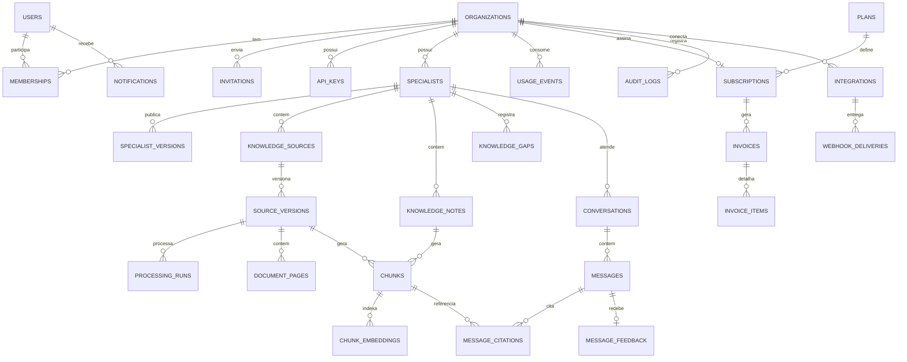

# Modelo de Dados
### Plataforma de Especialistas de IA · PostgreSQL 17+ com pgvector
**Database Architect · Agosto/2026 · v1.0**

---

## 0. Quatro discordâncias com a lista que você pediu

Antes do schema, os pontos onde eu não faria o que foi pedido.

### 0.1 `permissions` como tabela é armadilha agora

Você pediu `roles` **e** `permissions`. Um modelo RBAC completo
(`roles ↔ role_permissions ↔ permissions`) para **três papéis fixos** custa quatro tabelas,
quatro joins em toda verificação e a certeza de que ninguém vai usar a flexibilidade.

**Decisão:** `role` é uma coluna com CHECK em `memberships`. A matriz de permissões vive em
código, versionada com o resto. Quando houver cliente pedindo papel customizado — e só
então — as tabelas entram sem quebrar nada, porque a coluna vira FK.

### 0.2 `knowledge_bases` como entidade separada não existe

No MVP há um especialista por organização, e a biblioteca é dele. Uma tabela `knowledge_bases`
entre especialista e documento cria um nível de hierarquia que **não aparece em nenhuma tela**
e que todo query vai ter que atravessar.

**Decisão:** documentos apontam direto para `specialist_id`. Se um dia um acervo for
compartilhado entre especialistas, isso vira tabela de junção — mudança aditiva, sem migração
destrutiva.

### 0.3 Soft delete universal está errado

Soft delete em tudo quebra três coisas: unicidade (não dá para recriar um e-mail que "existe"
apagado), integridade referencial (filhos vivos apontando para pais mortos) e LGPD (direito à
eliminação é eliminação, não flag).

**Decisão — três políticas explícitas:**

| Política | Onde | Comportamento |
|---|---|---|
| **Soft delete** | Organizações, especialistas, fontes, notas internas | `deleted_at`, com índice único parcial |
| **Arquivamento** | Documentos, memberships, chaves de API | `status`/`revoked_at` — o registro continua válido, só não é mais ativo |
| **Hard delete** | Convites expirados, cache, entregas de webhook, notificações lidas | Removido de fato, por rotina de expurgo |

### 0.4 `specialist_versions` versiona a coisa errada se não for explícito

Um erro comum: usar a mesma tabela para versionar **configuração** (instruções, escopo, tom) e
**conhecimento** (quais documentos e versões estavam ativos). São ciclos de vida diferentes —
configuração muda raramente e por decisão humana; conhecimento muda toda semana.

**Decisão:** `specialist_versions` guarda o snapshot de **configuração publicada**.
O estado do conhecimento é um contador monotônico em `specialists.knowledge_version`,
incrementado por trigger a cada mudança de fonte. Ele é o que invalida cache e o que a
citação registra.

---

## 1. Convenções

| Convenção | Regra |
|---|---|
| Chave primária | `uuid` gerada por UUIDv7 (ordenada no tempo — evita fragmentação de índice do v4). PG 18 tem `uuidv7()` nativo; abaixo disso, gerar na aplicação |
| Timestamps | `timestamptz` sempre, em UTC. `created_at` e `updated_at` em toda tabela (via trigger) |
| Enums | `text` + `CHECK`, nunca `CREATE TYPE ... AS ENUM` — adicionar valor a enum é DDL com trava; CHECK é `ALTER ... VALIDATE` sem bloqueio de leitura |
| Dinheiro | `numeric`, nunca `float`. Custo de IA em `numeric(14,8)` (frações de centavo importam) |
| Nomes | Tabelas no plural, colunas em `snake_case`, FK como `<entidade>_id` |
| `org_id` | **Presente em toda tabela multi-tenant, mesmo quando derivável por FK** |
| Chaves estrangeiras | **Compostas `(org_id, id)`** entre entidades do mesmo tenant |
| JSONB | Só para dados sem consulta estruturada (metadados de auditoria, entitlements) |

### 1.1 O padrão de FK composta — a decisão mais importante do modelo

```sql
-- Pai expõe uma unicidade composta
ALTER TABLE specialists ADD CONSTRAINT specialists_org_id_uk UNIQUE (org_id, id);

-- Filho referencia o par, não só o id
ALTER TABLE knowledge_sources
  ADD CONSTRAINT ks_specialist_fk
  FOREIGN KEY (org_id, specialist_id) REFERENCES specialists (org_id, id);
```

Com isso, **é fisicamente impossível** anexar um documento da organização A a um especialista
da organização B — mesmo com bug na aplicação, mesmo com RLS mal configurada, mesmo por SQL
manual. É uma terceira camada de isolamento, abaixo da aplicação e da RLS, e custa apenas uma
coluna denormalizada.

---

## 2. Diagrama de entidades



---

## 3. Schema

### 3.1 Extensões e utilitários

```sql
CREATE EXTENSION IF NOT EXISTS vector;
CREATE EXTENSION IF NOT EXISTS pg_trgm;
CREATE EXTENSION IF NOT EXISTS unaccent;
CREATE EXTENSION IF NOT EXISTS btree_gin;

-- unaccent NÃO é IMMUTABLE por padrão e por isso não pode ser usado
-- em coluna gerada. Wrapper obrigatório:
CREATE OR REPLACE FUNCTION public.f_unaccent(text)
RETURNS text LANGUAGE sql IMMUTABLE PARALLEL SAFE STRICT AS
$$ SELECT public.unaccent('public.unaccent', $1) $$;

-- Configuração de busca em português sem acento
CREATE TEXT SEARCH CONFIGURATION pt_unaccent (COPY = portuguese);
ALTER TEXT SEARCH CONFIGURATION pt_unaccent
  ALTER MAPPING FOR hword, hword_part, word
  WITH unaccent, portuguese_stem;

CREATE OR REPLACE FUNCTION set_updated_at() RETURNS trigger
LANGUAGE plpgsql AS $$
BEGIN NEW.updated_at = now(); RETURN NEW; END $$;
```

### 3.2 Identidade e tenancy

```sql
CREATE TABLE organizations (
  id            uuid PRIMARY KEY DEFAULT uuidv7(),
  name          text NOT NULL CHECK (length(btrim(name)) BETWEEN 2 AND 120),
  slug          citext NOT NULL,
  document      text,                       -- CNPJ
  logo_url      text,
  timezone      text NOT NULL DEFAULT 'America/Sao_Paulo',
  status        text NOT NULL DEFAULT 'active'
                CHECK (status IN ('trial','active','past_due','suspended','cancelled')),
  settings      jsonb NOT NULL DEFAULT '{}'::jsonb,
  created_at    timestamptz NOT NULL DEFAULT now(),
  updated_at    timestamptz NOT NULL DEFAULT now(),
  deleted_at    timestamptz
);
CREATE UNIQUE INDEX organizations_slug_uk ON organizations (slug) WHERE deleted_at IS NULL;
CREATE UNIQUE INDEX organizations_document_uk ON organizations (document)
  WHERE deleted_at IS NULL AND document IS NOT NULL;

CREATE TABLE users (
  id                uuid PRIMARY KEY DEFAULT uuidv7(),
  email             citext NOT NULL,
  name              text NOT NULL,
  avatar_url        text,
  password_hash     text,                   -- nulo se só usa link mágico
  email_verified_at timestamptz,
  last_seen_at      timestamptz,
  created_at        timestamptz NOT NULL DEFAULT now(),
  updated_at        timestamptz NOT NULL DEFAULT now(),
  deleted_at        timestamptz
);
CREATE UNIQUE INDEX users_email_uk ON users (email) WHERE deleted_at IS NULL;

-- users é GLOBAL (uma pessoa pode pertencer a duas corretoras).
-- É a única tabela de negócio sem org_id — e por isso não tem RLS de tenant.

CREATE TABLE memberships (
  id          uuid PRIMARY KEY DEFAULT uuidv7(),
  org_id      uuid NOT NULL REFERENCES organizations(id) ON DELETE CASCADE,
  user_id     uuid NOT NULL REFERENCES users(id) ON DELETE CASCADE,
  role        text NOT NULL CHECK (role IN ('owner','admin','member')),
  status      text NOT NULL DEFAULT 'active'
              CHECK (status IN ('active','disabled')),
  invited_by  uuid REFERENCES users(id),
  joined_at   timestamptz NOT NULL DEFAULT now(),
  created_at  timestamptz NOT NULL DEFAULT now(),
  updated_at  timestamptz NOT NULL DEFAULT now()
);
CREATE UNIQUE INDEX memberships_org_user_uk ON memberships (org_id, user_id);
CREATE INDEX memberships_user_idx ON memberships (user_id) WHERE status = 'active';

-- Garante ao menos um owner ativo por organização
CREATE UNIQUE INDEX memberships_single_owner_guard
  ON memberships (org_id, role) WHERE role = 'owner' AND status = 'active';
```

> A guarda de owner acima é intencionalmente restritiva: **exatamente um** owner ativo.
> Se o produto precisar de vários, troque por um trigger que verifica `count(*) >= 1` no
> `AFTER UPDATE/DELETE`. O que não pode existir é organização órfã.

```sql
CREATE TABLE invitations (
  id          uuid PRIMARY KEY DEFAULT uuidv7(),
  org_id      uuid NOT NULL REFERENCES organizations(id) ON DELETE CASCADE,
  email       citext NOT NULL,
  role        text NOT NULL CHECK (role IN ('admin','member')),
  token_hash  text NOT NULL,               -- nunca o token em claro
  invited_by  uuid NOT NULL REFERENCES users(id),
  expires_at  timestamptz NOT NULL,
  accepted_at timestamptz,
  created_at  timestamptz NOT NULL DEFAULT now(),
  updated_at  timestamptz NOT NULL DEFAULT now()
);
CREATE UNIQUE INDEX invitations_pending_uk ON invitations (org_id, email)
  WHERE accepted_at IS NULL;
CREATE UNIQUE INDEX invitations_token_uk ON invitations (token_hash);
CREATE INDEX invitations_expiry_idx ON invitations (expires_at) WHERE accepted_at IS NULL;

CREATE TABLE api_keys (
  id           uuid PRIMARY KEY DEFAULT uuidv7(),
  org_id       uuid NOT NULL REFERENCES organizations(id) ON DELETE CASCADE,
  name         text NOT NULL,
  prefix       text NOT NULL,              -- 8 chars visíveis, para localizar
  key_hash     text NOT NULL,              -- somente hash
  scopes       text[] NOT NULL DEFAULT '{}',
  last_used_at timestamptz,
  expires_at   timestamptz,
  revoked_at   timestamptz,
  created_by   uuid NOT NULL REFERENCES users(id),
  created_at   timestamptz NOT NULL DEFAULT now(),
  updated_at   timestamptz NOT NULL DEFAULT now()
);
CREATE UNIQUE INDEX api_keys_hash_uk ON api_keys (key_hash);
CREATE INDEX api_keys_prefix_idx ON api_keys (prefix) WHERE revoked_at IS NULL;
```

### 3.3 Especialistas

```sql
CREATE TABLE specialists (
  id                uuid PRIMARY KEY DEFAULT uuidv7(),
  org_id            uuid NOT NULL REFERENCES organizations(id) ON DELETE CASCADE,
  name              text NOT NULL,
  description       text,
  branch            text NOT NULL,          -- ramo: residencial, auto, vida...
  insurers          text[] NOT NULL DEFAULT '{}',
  status            text NOT NULL DEFAULT 'draft'
                    CHECK (status IN ('draft','published','archived')),
  config            jsonb NOT NULL DEFAULT '{}'::jsonb,   -- tom, regras, escopo
  out_of_scope      text[] NOT NULL DEFAULT '{}',
  knowledge_version bigint NOT NULL DEFAULT 0,  -- ↑ a cada mudança de acervo
  published_at      timestamptz,
  created_by        uuid NOT NULL REFERENCES users(id),
  created_at        timestamptz NOT NULL DEFAULT now(),
  updated_at        timestamptz NOT NULL DEFAULT now(),
  deleted_at        timestamptz,
  CONSTRAINT specialists_org_uk UNIQUE (org_id, id),
  CONSTRAINT specialists_published_chk
    CHECK (status <> 'published' OR published_at IS NOT NULL)
);
CREATE INDEX specialists_org_idx ON specialists (org_id) WHERE deleted_at IS NULL;

CREATE TABLE specialist_versions (
  id                 uuid PRIMARY KEY DEFAULT uuidv7(),
  org_id             uuid NOT NULL,
  specialist_id      uuid NOT NULL,
  version_number     integer NOT NULL,
  config_snapshot    jsonb NOT NULL,          -- config congelada na publicação
  knowledge_version  bigint NOT NULL,         -- acervo no momento da publicação
  test_pass_rate     numeric(5,2),            -- taxa do modo teste na publicação
  published_by       uuid NOT NULL REFERENCES users(id),
  published_at       timestamptz NOT NULL DEFAULT now(),
  created_at         timestamptz NOT NULL DEFAULT now(),
  FOREIGN KEY (org_id, specialist_id) REFERENCES specialists (org_id, id) ON DELETE CASCADE
);
CREATE UNIQUE INDEX specialist_versions_uk
  ON specialist_versions (specialist_id, version_number);
```

> `test_pass_rate` guardado na versão publicada é detalhe pequeno com valor grande: registra
> **com qual nível de confiança medido** aquela configuração foi ao ar. É defesa em auditoria
> e é diagnóstico quando a qualidade cai.

### 3.4 Conhecimento

```sql
CREATE TABLE knowledge_sources (
  id             uuid PRIMARY KEY DEFAULT uuidv7(),
  org_id         uuid NOT NULL,
  specialist_id  uuid NOT NULL,
  kind           text NOT NULL CHECK (kind IN ('public_document','org_document','internal_note')),
  title          text NOT NULL,
  insurer        text,
  product        text,
  susep_process  text,
  origin         text NOT NULL DEFAULT 'upload'
                 CHECK (origin IN ('upload','preloaded','written')),
  status         text NOT NULL DEFAULT 'active'
                 CHECK (status IN ('active','inactive','archived')),
  created_by     uuid REFERENCES users(id),
  created_at     timestamptz NOT NULL DEFAULT now(),
  updated_at     timestamptz NOT NULL DEFAULT now(),
  deleted_at     timestamptz,
  CONSTRAINT knowledge_sources_org_uk UNIQUE (org_id, id),
  FOREIGN KEY (org_id, specialist_id) REFERENCES specialists (org_id, id) ON DELETE CASCADE
);
CREATE INDEX ks_specialist_idx ON knowledge_sources (specialist_id, status)
  WHERE deleted_at IS NULL;
CREATE INDEX ks_insurer_idx ON knowledge_sources (org_id, insurer)
  WHERE deleted_at IS NULL AND insurer IS NOT NULL;

CREATE TABLE source_versions (
  id                uuid PRIMARY KEY DEFAULT uuidv7(),
  org_id            uuid NOT NULL,
  source_id         uuid NOT NULL,
  version_number    integer NOT NULL,
  file_key          text,                    -- chave no R2; nulo para nota interna
  file_name         text,
  file_size_bytes   bigint CHECK (file_size_bytes IS NULL OR file_size_bytes > 0),
  mime_type         text,
  checksum_sha256   text,
  page_count        integer,
  valid_from        date,
  valid_until       date,
  status            text NOT NULL DEFAULT 'queued'
                    CHECK (status IN ('queued','processing','ready','ready_with_warnings','failed','superseded')),
  warning_summary   jsonb,                   -- páginas ilegíveis, baixa confiança de OCR
  is_current        boolean NOT NULL DEFAULT true,
  created_by        uuid REFERENCES users(id),
  created_at        timestamptz NOT NULL DEFAULT now(),
  updated_at        timestamptz NOT NULL DEFAULT now(),
  CONSTRAINT sv_org_uk UNIQUE (org_id, id),
  CONSTRAINT sv_validity_chk CHECK (valid_until IS NULL OR valid_from IS NULL OR valid_until >= valid_from),
  FOREIGN KEY (org_id, source_id) REFERENCES knowledge_sources (org_id, id) ON DELETE CASCADE
);
CREATE UNIQUE INDEX sv_number_uk ON source_versions (source_id, version_number);
-- Apenas UMA versão corrente por fonte
CREATE UNIQUE INDEX sv_current_uk ON source_versions (source_id) WHERE is_current;
CREATE UNIQUE INDEX sv_checksum_uk ON source_versions (org_id, checksum_sha256)
  WHERE checksum_sha256 IS NOT NULL;
CREATE INDEX sv_status_idx ON source_versions (org_id, status) WHERE status <> 'superseded';
CREATE INDEX sv_expiring_idx ON source_versions (org_id, valid_until)
  WHERE is_current AND valid_until IS NOT NULL;
```

> `sv_checksum_uk` mata duplicata silenciosa: a mesma CG enviada duas vezes por pessoas
> diferentes é rejeitada com mensagem clara em vez de duplicar o acervo e produzir "conflito
> entre documentos" que na verdade é o mesmo documento.

```sql
CREATE TABLE processing_runs (
  id               uuid PRIMARY KEY DEFAULT uuidv7(),
  org_id           uuid NOT NULL,
  source_version_id uuid NOT NULL,
  attempt          integer NOT NULL DEFAULT 1,
  stage            text NOT NULL DEFAULT 'queued'
                   CHECK (stage IN ('queued','extracting','ocr','structuring','chunking','embedding','indexing','done','failed')),
  pages_done       integer NOT NULL DEFAULT 0,
  pages_total      integer,
  ocr_used         boolean NOT NULL DEFAULT false,
  low_confidence_pages integer[] NOT NULL DEFAULT '{}',
  error_code       text,
  error_message    text,
  cost             numeric(14,8) NOT NULL DEFAULT 0,
  started_at       timestamptz,
  finished_at      timestamptz,
  created_at       timestamptz NOT NULL DEFAULT now(),
  updated_at       timestamptz NOT NULL DEFAULT now(),
  FOREIGN KEY (org_id, source_version_id) REFERENCES source_versions (org_id, id) ON DELETE CASCADE
);
CREATE INDEX pr_version_idx ON processing_runs (source_version_id, attempt DESC);
CREATE INDEX pr_active_idx ON processing_runs (org_id, stage)
  WHERE stage NOT IN ('done','failed');
```

> **`processing_runs` não substitui a fila.** O pg-boss tem esquema próprio (`pgboss.job`) e
> cuida de retry, agendamento e concorrência. Esta tabela é o **estado de domínio**, que a
> interface lê e que sobrevive a qualquer troca de fila. Misturar as duas coisas é o erro
> clássico: acopla a UI ao mecanismo de fila.

```sql
CREATE TABLE document_pages (
  id                uuid PRIMARY KEY DEFAULT uuidv7(),
  org_id            uuid NOT NULL,
  source_version_id uuid NOT NULL,
  page_number       integer NOT NULL CHECK (page_number > 0),
  text_content      text,
  image_key         text,                    -- render da página no R2
  ocr_confidence    numeric(4,3) CHECK (ocr_confidence BETWEEN 0 AND 1),
  is_indexable      boolean NOT NULL DEFAULT true,
  created_at        timestamptz NOT NULL DEFAULT now(),
  FOREIGN KEY (org_id, source_version_id) REFERENCES source_versions (org_id, id) ON DELETE CASCADE
);
CREATE UNIQUE INDEX dp_page_uk ON document_pages (source_version_id, page_number);

CREATE TABLE chunks (
  id                uuid PRIMARY KEY DEFAULT uuidv7(),
  org_id            uuid NOT NULL,
  specialist_id     uuid NOT NULL,
  source_version_id uuid NOT NULL,
  ordinal           integer NOT NULL,
  clause_path       text,                    -- '4 › 4.2 › 4.2.1'
  clause_title      text,
  heading_trail     text[],                  -- títulos ancestrais
  section_kind      text CHECK (section_kind IN
                    ('coverage','exclusion','waiting_period','definition','procedure','general','table')),
  page_start        integer,
  page_end          integer,
  content           text NOT NULL,
  token_count       integer,
  content_tsv       tsvector GENERATED ALWAYS AS (
                      to_tsvector('pt_unaccent',
                        coalesce(clause_title,'') || ' ' || content)
                    ) STORED,
  created_at        timestamptz NOT NULL DEFAULT now(),
  CONSTRAINT chunks_org_uk UNIQUE (org_id, id),
  FOREIGN KEY (org_id, source_version_id) REFERENCES source_versions (org_id, id) ON DELETE CASCADE
);
CREATE UNIQUE INDEX chunks_version_ordinal_uk ON chunks (source_version_id, ordinal);
CREATE INDEX chunks_tsv_idx ON chunks USING gin (content_tsv);
CREATE INDEX chunks_scope_idx ON chunks (org_id, specialist_id);
CREATE INDEX chunks_section_idx ON chunks (org_id, specialist_id, section_kind)
  WHERE section_kind IN ('exclusion','waiting_period');
```

> `section_kind` com índice parcial em `exclusion` e `waiting_period` é o que torna barata a
> **expansão obrigatória cobertura ⇄ exclusão** da arquitetura RAG. Sem essa classificação na
> ingestão, aquela regra vira busca semântica torcendo por sorte.

```sql
CREATE TABLE chunk_embeddings (
  chunk_id        uuid NOT NULL,
  org_id          uuid NOT NULL,
  specialist_id   uuid NOT NULL,
  model           text NOT NULL,             -- 'provider/model-name'
  model_version   text NOT NULL,
  dimensions      smallint NOT NULL,
  embedding       vector(1024) NOT NULL,
  created_at      timestamptz NOT NULL DEFAULT now(),
  PRIMARY KEY (chunk_id, model, model_version),
  FOREIGN KEY (org_id, chunk_id) REFERENCES chunks (org_id, id) ON DELETE CASCADE
);
```

> **Por que tabela separada e não coluna em `chunks`:** permite N modelos simultâneos durante
> uma migração de embeddings, com índice HNSW **parcial por modelo**. A alternativa (duas
> colunas de vetor) limita a duas e engorda a tabela quente de `chunks`, que é lida a todo
> momento pela citação. Isto refina o ADR-007 da arquitetura.

```sql
-- Índice HNSW parcial por modelo — ver seção 6 para os parâmetros
CREATE INDEX chunk_emb_hnsw_v1 ON chunk_embeddings
  USING hnsw (embedding vector_cosine_ops)
  WITH (m = 16, ef_construction = 64)
  WHERE model = 'provider/embed-v1';

CREATE TABLE knowledge_notes (
  id             uuid PRIMARY KEY DEFAULT uuidv7(),
  org_id         uuid NOT NULL,
  source_id      uuid NOT NULL,             -- toda nota também é uma fonte
  title          text NOT NULL,
  body           text NOT NULL,
  insurers       text[] NOT NULL DEFAULT '{}',
  valid_until    date,
  status         text NOT NULL DEFAULT 'active'
                 CHECK (status IN ('draft','active','archived')),
  author_id      uuid NOT NULL REFERENCES users(id),
  resolved_gap_id uuid,
  usage_count    integer NOT NULL DEFAULT 0,
  created_at     timestamptz NOT NULL DEFAULT now(),
  updated_at     timestamptz NOT NULL DEFAULT now(),
  deleted_at     timestamptz,
  FOREIGN KEY (org_id, source_id) REFERENCES knowledge_sources (org_id, id) ON DELETE CASCADE
);
CREATE INDEX kn_org_status_idx ON knowledge_notes (org_id, status) WHERE deleted_at IS NULL;

CREATE TABLE knowledge_gaps (
  id              uuid PRIMARY KEY DEFAULT uuidv7(),
  org_id          uuid NOT NULL,
  specialist_id   uuid NOT NULL,
  question_norm   text NOT NULL,             -- pergunta normalizada
  question_sample text NOT NULL,             -- exemplo original
  occurrence_count integer NOT NULL DEFAULT 1,
  first_seen_at   timestamptz NOT NULL DEFAULT now(),
  last_seen_at    timestamptz NOT NULL DEFAULT now(),
  status          text NOT NULL DEFAULT 'open'
                  CHECK (status IN ('open','resolved','out_of_scope','ignored')),
  resolved_by     uuid REFERENCES users(id),
  resolved_note_id uuid REFERENCES knowledge_notes(id) ON DELETE SET NULL,
  resolved_at     timestamptz,
  created_at      timestamptz NOT NULL DEFAULT now(),
  updated_at      timestamptz NOT NULL DEFAULT now(),
  FOREIGN KEY (org_id, specialist_id) REFERENCES specialists (org_id, id) ON DELETE CASCADE
);
CREATE UNIQUE INDEX kg_question_uk ON knowledge_gaps (specialist_id, md5(question_norm));
CREATE INDEX kg_open_idx ON knowledge_gaps (org_id, occurrence_count DESC) WHERE status = 'open';

CREATE TABLE knowledge_gap_askers (
  gap_id     uuid NOT NULL REFERENCES knowledge_gaps(id) ON DELETE CASCADE,
  user_id    uuid NOT NULL REFERENCES users(id) ON DELETE CASCADE,
  asked_at   timestamptz NOT NULL DEFAULT now(),
  notified_at timestamptz,
  PRIMARY KEY (gap_id, user_id)
);
```

> `knowledge_gap_askers` existe para uma única razão de produto: quando a lacuna é resolvida,
> **quem perguntou é notificado**. É o que fecha o ciclo da jornada J4 e ensina o time a
> continuar perguntando em vez de desistir.

### 3.5 Consulta

```sql
CREATE TABLE conversations (
  id            uuid PRIMARY KEY DEFAULT uuidv7(),
  org_id        uuid NOT NULL,
  specialist_id uuid NOT NULL,
  user_id       uuid REFERENCES users(id) ON DELETE SET NULL,
  title         text,
  mode          text NOT NULL DEFAULT 'live' CHECK (mode IN ('live','test')),
  message_count integer NOT NULL DEFAULT 0,
  last_message_at timestamptz,
  created_at    timestamptz NOT NULL DEFAULT now(),
  updated_at    timestamptz NOT NULL DEFAULT now(),
  CONSTRAINT conv_org_uk UNIQUE (org_id, id),
  FOREIGN KEY (org_id, specialist_id) REFERENCES specialists (org_id, id) ON DELETE CASCADE
);
CREATE INDEX conv_user_recent_idx ON conversations (org_id, user_id, last_message_at DESC);

CREATE TABLE messages (
  id                uuid PRIMARY KEY DEFAULT uuidv7(),
  org_id            uuid NOT NULL,
  conversation_id   uuid NOT NULL,
  role              text NOT NULL CHECK (role IN ('user','assistant')),
  content           text NOT NULL,
  -- somente em mensagens do assistente:
  confidence        text CHECK (confidence IN ('grounded','partial','conflicting','not_found','out_of_scope')),
  insurer_scope     text[],
  knowledge_version bigint,                  -- estado do acervo no momento
  specialist_version_id uuid,
  model             text,
  latency_ms        integer,
  cache_hit         boolean NOT NULL DEFAULT false,
  created_at        timestamptz NOT NULL DEFAULT now(),
  CONSTRAINT msg_org_uk UNIQUE (org_id, id),
  CONSTRAINT msg_confidence_chk
    CHECK ((role = 'assistant') = (confidence IS NOT NULL)),
  FOREIGN KEY (org_id, conversation_id) REFERENCES conversations (org_id, id) ON DELETE CASCADE
);
CREATE INDEX msg_conv_idx ON messages (conversation_id, created_at);
CREATE INDEX msg_confidence_idx ON messages (org_id, confidence, created_at DESC)
  WHERE role = 'assistant';

CREATE TABLE message_citations (
  id                uuid PRIMARY KEY DEFAULT uuidv7(),
  org_id            uuid NOT NULL,
  message_id        uuid NOT NULL,
  ordinal           smallint NOT NULL,
  -- Referência viva (pode virar NULL se a fonte for removida)
  chunk_id          uuid REFERENCES chunks(id) ON DELETE SET NULL,
  source_version_id uuid REFERENCES source_versions(id) ON DELETE SET NULL,
  -- SNAPSHOT IMUTÁVEL — sobrevive à remoção da fonte
  source_title      text NOT NULL,
  insurer           text,
  version_label     text NOT NULL,
  clause_path       text,
  page_number       integer,
  excerpt           text NOT NULL,
  relevance_score   numeric(6,4),
  was_opened        boolean NOT NULL DEFAULT false,
  created_at        timestamptz NOT NULL DEFAULT now(),
  FOREIGN KEY (org_id, message_id) REFERENCES messages (org_id, id) ON DELETE CASCADE
);
CREATE UNIQUE INDEX mc_message_ordinal_uk ON message_citations (message_id, ordinal);
CREATE INDEX mc_source_idx ON message_citations (org_id, source_version_id);
```

> **O snapshot da citação é a decisão mais importante desta seção.** Se a corretora precisar
> provar em março de 2028 o que foi informado em agosto de 2026, a citação tem que estar
> íntegra mesmo que o documento tenha sido substituído, arquivado ou removido. FK sozinha não
> garante isso — dado desnormalizado garante. `was_opened` alimenta a North Star do PRD.

```sql
CREATE TABLE message_feedback (
  message_id  uuid PRIMARY KEY,
  org_id      uuid NOT NULL,
  user_id     uuid NOT NULL REFERENCES users(id) ON DELETE CASCADE,
  verdict     text NOT NULL CHECK (verdict IN ('correct','incorrect','incomplete')),
  comment     text,
  status      text NOT NULL DEFAULT 'pending'
              CHECK (status IN ('pending','reviewed','dismissed','fixed')),
  reviewed_by uuid REFERENCES users(id),
  created_at  timestamptz NOT NULL DEFAULT now(),
  updated_at  timestamptz NOT NULL DEFAULT now(),
  FOREIGN KEY (org_id, message_id) REFERENCES messages (org_id, id) ON DELETE CASCADE
);
CREATE INDEX mf_pending_idx ON message_feedback (org_id, created_at DESC) WHERE status = 'pending';

CREATE TABLE answer_cache (
  id                uuid PRIMARY KEY DEFAULT uuidv7(),
  org_id            uuid NOT NULL,
  specialist_id     uuid NOT NULL,
  cache_key         text NOT NULL,          -- hash(pergunta_norm + escopo + knowledge_version)
  knowledge_version bigint NOT NULL,
  answer            text NOT NULL,
  citations         jsonb NOT NULL,
  confidence        text NOT NULL,
  hit_count         integer NOT NULL DEFAULT 0,
  last_hit_at       timestamptz,
  expires_at        timestamptz NOT NULL,
  created_at        timestamptz NOT NULL DEFAULT now(),
  FOREIGN KEY (org_id, specialist_id) REFERENCES specialists (org_id, id) ON DELETE CASCADE
);
CREATE UNIQUE INDEX ac_key_uk ON answer_cache (specialist_id, cache_key);
CREATE INDEX ac_expiry_idx ON answer_cache (expires_at);
CREATE INDEX ac_stale_idx ON answer_cache (specialist_id, knowledge_version);
```

> Como `knowledge_version` faz parte da chave, mudar o acervo **invalida por construção** —
> não há job de invalidação para falhar. O expurgo de linhas obsoletas é higiene, não correção.

### 3.6 Uso, planos e cobrança

```sql
CREATE TABLE plans (
  id            uuid PRIMARY KEY DEFAULT uuidv7(),
  code          text NOT NULL UNIQUE,
  name          text NOT NULL,
  price_cents   integer NOT NULL CHECK (price_cents >= 0),
  currency      char(3) NOT NULL DEFAULT 'BRL',
  billing_period text NOT NULL CHECK (billing_period IN ('monthly','yearly')),
  entitlements  jsonb NOT NULL,   -- {seats, specialists, storage_gb, queries_included}
  overage_price_cents integer,
  is_active     boolean NOT NULL DEFAULT true,
  created_at    timestamptz NOT NULL DEFAULT now(),
  updated_at    timestamptz NOT NULL DEFAULT now()
);

CREATE TABLE subscriptions (
  id                    uuid PRIMARY KEY DEFAULT uuidv7(),
  org_id                uuid NOT NULL REFERENCES organizations(id) ON DELETE CASCADE,
  plan_id               uuid NOT NULL REFERENCES plans(id),
  status                text NOT NULL
                        CHECK (status IN ('trialing','active','past_due','cancelled','expired')),
  seats                 integer NOT NULL DEFAULT 1 CHECK (seats > 0),
  current_period_start  timestamptz NOT NULL,
  current_period_end    timestamptz NOT NULL,
  trial_ends_at         timestamptz,
  cancel_at_period_end  boolean NOT NULL DEFAULT false,
  cancelled_at          timestamptz,
  external_ref          text,               -- id no gateway
  created_at            timestamptz NOT NULL DEFAULT now(),
  updated_at            timestamptz NOT NULL DEFAULT now(),
  CONSTRAINT sub_period_chk CHECK (current_period_end > current_period_start)
);
CREATE UNIQUE INDEX sub_active_org_uk ON subscriptions (org_id)
  WHERE status IN ('trialing','active','past_due');

CREATE TABLE invoices (
  id             uuid PRIMARY KEY DEFAULT uuidv7(),
  org_id         uuid NOT NULL REFERENCES organizations(id) ON DELETE RESTRICT,
  subscription_id uuid REFERENCES subscriptions(id) ON DELETE SET NULL,
  number         text NOT NULL,
  status         text NOT NULL
                 CHECK (status IN ('draft','open','paid','void','uncollectible')),
  subtotal_cents integer NOT NULL,
  tax_cents      integer NOT NULL DEFAULT 0,
  total_cents    integer NOT NULL,
  currency       char(3) NOT NULL DEFAULT 'BRL',
  period_start   timestamptz NOT NULL,
  period_end     timestamptz NOT NULL,
  due_at         timestamptz,
  paid_at        timestamptz,
  payment_method text CHECK (payment_method IN ('pix','boleto','card')),
  external_ref   text,
  nfse_number    text,
  created_at     timestamptz NOT NULL DEFAULT now(),
  updated_at     timestamptz NOT NULL DEFAULT now()
);
CREATE UNIQUE INDEX invoices_number_uk ON invoices (number);
CREATE INDEX invoices_org_idx ON invoices (org_id, created_at DESC);

CREATE TABLE invoice_items (
  id          uuid PRIMARY KEY DEFAULT uuidv7(),
  invoice_id  uuid NOT NULL REFERENCES invoices(id) ON DELETE CASCADE,
  description text NOT NULL,
  quantity    numeric(12,4) NOT NULL DEFAULT 1,
  unit_price_cents integer NOT NULL,
  amount_cents integer NOT NULL,
  kind        text NOT NULL CHECK (kind IN ('subscription','seat','overage','discount','adjustment'))
);

CREATE TABLE usage_events (
  id            uuid NOT NULL DEFAULT uuidv7(),
  org_id        uuid NOT NULL,
  user_id       uuid,
  specialist_id uuid,
  message_id    uuid,
  kind          text NOT NULL
                CHECK (kind IN ('query','ingestion','embedding','rerank','transcription')),
  model         text,
  input_tokens  integer,
  output_tokens integer,
  units         numeric(12,4) NOT NULL DEFAULT 1,
  cost          numeric(14,8) NOT NULL DEFAULT 0,
  cache_hit     boolean NOT NULL DEFAULT false,
  latency_ms    integer,
  occurred_at   timestamptz NOT NULL DEFAULT now(),
  PRIMARY KEY (id, occurred_at)
) PARTITION BY RANGE (occurred_at);

CREATE INDEX ue_org_time_idx ON usage_events (org_id, occurred_at DESC);
CREATE INDEX ue_billing_idx ON usage_events (org_id, kind, occurred_at) WHERE NOT cache_hit;

-- Rollup diário: nenhuma tela de analytics consulta a tabela bruta
CREATE TABLE usage_daily (
  org_id      uuid NOT NULL,
  day         date NOT NULL,
  kind        text NOT NULL,
  event_count integer NOT NULL,
  units       numeric(14,4) NOT NULL,
  cost        numeric(14,8) NOT NULL,
  cache_hits  integer NOT NULL DEFAULT 0,
  PRIMARY KEY (org_id, day, kind)
);
```

> `usage_events` já nasce **particionada por mês**. Ela é a tabela de maior crescimento do
> sistema e a que você mais vai lamentar não ter particionado — reparticionar com dados de
> cliente dentro é a migração mais dolorosa que existe. É barato hoje e caro depois.

### 3.7 Plataforma

```sql
CREATE TABLE audit_logs (
  id           uuid NOT NULL DEFAULT uuidv7(),
  org_id       uuid NOT NULL,
  actor_id     uuid,
  actor_type   text NOT NULL DEFAULT 'user'
               CHECK (actor_type IN ('user','system','api_key')),
  action       text NOT NULL,               -- 'source.uploaded', 'specialist.published'
  entity_type  text NOT NULL,
  entity_id    uuid,
  metadata     jsonb NOT NULL DEFAULT '{}'::jsonb,
  ip_address   inet,
  user_agent   text,
  occurred_at  timestamptz NOT NULL DEFAULT now(),
  PRIMARY KEY (id, occurred_at)
) PARTITION BY RANGE (occurred_at);

CREATE INDEX al_org_time_idx ON audit_logs (org_id, occurred_at DESC);
CREATE INDEX al_entity_idx ON audit_logs (org_id, entity_type, entity_id);

-- Append-only imposto pelo banco, não pela aplicação
REVOKE UPDATE, DELETE ON audit_logs FROM app_user;

CREATE TABLE notifications (
  id          uuid PRIMARY KEY DEFAULT uuidv7(),
  org_id      uuid NOT NULL,
  user_id     uuid NOT NULL REFERENCES users(id) ON DELETE CASCADE,
  kind        text NOT NULL,   -- 'gap.resolved', 'ingestion.failed', 'document.expiring'
  title       text NOT NULL,
  body        text,
  link_url    text,
  read_at     timestamptz,
  created_at  timestamptz NOT NULL DEFAULT now()
);
CREATE INDEX notif_unread_idx ON notifications (user_id, created_at DESC) WHERE read_at IS NULL;

CREATE TABLE integrations (
  id          uuid PRIMARY KEY DEFAULT uuidv7(),
  org_id      uuid NOT NULL REFERENCES organizations(id) ON DELETE CASCADE,
  provider    text NOT NULL,
  status      text NOT NULL DEFAULT 'active'
              CHECK (status IN ('active','error','disabled')),
  config      jsonb NOT NULL DEFAULT '{}'::jsonb,
  credentials_ref text,                     -- ponteiro para cofre; NUNCA o segredo
  last_sync_at timestamptz,
  created_at  timestamptz NOT NULL DEFAULT now(),
  updated_at  timestamptz NOT NULL DEFAULT now()
);
CREATE UNIQUE INDEX integrations_org_provider_uk ON integrations (org_id, provider);

CREATE TABLE webhook_endpoints (
  id          uuid PRIMARY KEY DEFAULT uuidv7(),
  org_id      uuid NOT NULL REFERENCES organizations(id) ON DELETE CASCADE,
  url         text NOT NULL,
  secret_ref  text NOT NULL,
  events      text[] NOT NULL,
  is_active   boolean NOT NULL DEFAULT true,
  created_at  timestamptz NOT NULL DEFAULT now(),
  updated_at  timestamptz NOT NULL DEFAULT now()
);

CREATE TABLE webhook_deliveries (
  id            uuid PRIMARY KEY DEFAULT uuidv7(),
  org_id        uuid NOT NULL,
  endpoint_id   uuid NOT NULL REFERENCES webhook_endpoints(id) ON DELETE CASCADE,
  event_type    text NOT NULL,
  payload       jsonb NOT NULL,
  status        text NOT NULL DEFAULT 'pending'
                CHECK (status IN ('pending','delivered','failed','dead')),
  attempts      integer NOT NULL DEFAULT 0,
  response_code integer,
  next_retry_at timestamptz,
  created_at    timestamptz NOT NULL DEFAULT now(),
  delivered_at  timestamptz
);
CREATE INDEX wd_pending_idx ON webhook_deliveries (next_retry_at) WHERE status = 'pending';
```

---

## 4. Isolamento multi-tenant

### 4.1 Política padrão

```sql
ALTER TABLE knowledge_sources ENABLE ROW LEVEL SECURITY;
ALTER TABLE knowledge_sources FORCE ROW LEVEL SECURITY;

CREATE POLICY tenant_isolation ON knowledge_sources
  USING (org_id = (SELECT current_setting('app.current_org', true)::uuid))
  WITH CHECK (org_id = (SELECT current_setting('app.current_org', true)::uuid));
```

Aplicada, com a mesma forma, em **toda** tabela que tem `org_id`.

**Três detalhes que decidem se isso funciona:**

1. **`FORCE ROW LEVEL SECURITY`** — sem isso, o dono da tabela ignora a política. Em migração
   você já está como dono; sem FORCE a proteção não existe onde mais importa testar.

2. **`(SELECT current_setting(...))` entre parênteses** — a subconsulta faz o planejador
   avaliar **uma vez** por query em vez de uma vez por linha. Sem esse detalhe, uma varredura
   de 600 mil chunks chama a função 600 mil vezes. É diferença de ordem de grandeza.

3. **`SET LOCAL` exige transação.** Com pooling em modo transação, `SET` sem `LOCAL` vaza
   contexto entre requisições de organizações diferentes — que é exatamente o vazamento que a
   RLS deveria impedir.

```sql
BEGIN;
  SET LOCAL app.current_org = '...';
  -- queries
COMMIT;
```

### 4.2 O worker

O worker roda com papel privilegiado e **não é coberto por RLS**. Cada job carrega `org_id`
e a conexão abre com o mesmo `SET LOCAL`. Este é o ponto mais provável de vazamento do
sistema inteiro.

**Teste obrigatório, critério de aceitação do MVP:**

```sql
-- Para cada tabela com org_id, com o contexto de A, tentar ler dados de B.
-- Resultado esperado: 0 linhas. Sempre. Inclusive nos caminhos do worker.
```

---

## 5. Timestamps, soft delete e integridade

| Aspecto | Implementação |
|---|---|
| `updated_at` | Trigger `BEFORE UPDATE` em todas as tabelas mutáveis |
| Soft delete | `deleted_at` + **índice único parcial** `WHERE deleted_at IS NULL` |
| Consultas | Toda leitura filtra `deleted_at IS NULL`; use uma view por tabela para não depender de disciplina |
| Expurgo | Job diário: convites expirados, cache vencido, notificações lidas há +90 dias, entregas concluídas há +30 dias |
| LGPD | Exclusão de organização = anonimização de `users` sem outro vínculo + remoção real de objetos no R2 em 30 dias |
| `ON DELETE` | `CASCADE` dentro do tenant; `RESTRICT` em `invoices` (dado fiscal não desaparece); `SET NULL` em citações |

---

## 6. Problemas de performance previstos

### P1 · Busca vetorial filtrada por tenant — **o problema mais grave**

HNSW é um índice de grafo global. Ele percorre o grafo e **depois** aplica o filtro
`org_id = X`. Numa base com 50 organizações, uma consulta que pede top-8 pode percorrer os
vizinhos mais próximos globais, descobrir que quase todos são de outras organizações e
devolver **menos resultados que o pedido — ou nenhum**. O sintoma clássico: funciona
perfeitamente com um cliente e degrada silenciosamente quando entra o décimo.

**Mitigações, em ordem de preferência:**

1. **Varredura iterativa de índice** (pgvector 0.8+): `SET hnsw.iterative_scan = relaxed_order`,
   que continua percorrendo até preencher o top-k após o filtro. É a resposta certa hoje.
2. **`ef_search` dinâmico** por tamanho do tenant: organização pequena precisa de `ef` maior.
3. **Busca exata para tenants pequenos:** abaixo de ~50 mil chunks, varredura sequencial com
   filtro é mais rápida **e** mais precisa que HNSW. Ter os dois caminhos e escolher por
   contagem é uma otimização legítima, não prematura.
4. **Particionar `chunk_embeddings` por hash de `org_id`** se a base passar de alguns milhões.

> Este é o problema que eu monitoraria desde o primeiro dia, com uma métrica explícita:
> *recall do golden set por tamanho de organização*. É o modo de falha que não aparece em
> teste de desenvolvimento e que só se manifesta com clientes reais dentro.

### P2 · Coluna gerada com `unaccent`

`unaccent` não é `IMMUTABLE` e o Postgres recusa a coluna gerada. Sem o wrapper `f_unaccent`
da seção 3.1, a migração falha. E há uma armadilha adicional: se a configuração de busca
mudar depois, **todas** as `tsvector` precisam ser regeradas — operação cara em 600 mil linhas.
Defina a configuração de texto antes de indexar em volume.

### P3 · Construção do índice HNSW durante ingestão em massa

Inserir 600 mil vetores com HNSW já criado é ordens de grandeza mais lento que inserir e
depois indexar. Na carga inicial do acervo público: importar sem índice, elevar
`maintenance_work_mem`, criar o índice depois. Em operação normal, o custo de inserção é
irrelevante — são dezenas de chunks por vez.

### P4 · Memória versus tamanho do índice

```
600.000 chunks × 1024 dim × 4 bytes ≈ 2,4 GB de vetores
Índice HNSW ≈ 1,5× a 2× isso   →  ~4 GB
```

Se o índice não couber em RAM, cada busca vira leitura de disco e a latência multiplica.
**Isso define o tamanho mínimo da instância** — não o número de usuários. Uma instância
subdimensionada com poucos clientes é mais lenta que uma bem dimensionada com muitos.

### P5 · `chunks` é tabela quente e larga

`content` é texto longo. Como `chunks` é lida em toda citação, o TOAST vira leitura extra.
Mitigado por manter os embeddings fora da tabela (seção 3.4) e por selecionar colunas
explicitamente — `SELECT *` em `chunks` é caro por construção.

### P6 · RLS e o planejador

Além do `(SELECT ...)` da seção 4.1: políticas de RLS podem impedir que o planejador empurre
condições para dentro de junções, transformando junção indexada em varredura. **Rode `EXPLAIN`
com RLS ativa**, nunca como superusuário — o plano é diferente e o teste sem RLS engana.

### P7 · Crescimento de `usage_events`

4.000 consultas/mês geram ~20 mil eventos. A 200 clientes, ~2 milhões/mês. Já particionada
por mês; nenhuma tela consulta a tabela bruta — analytics lê `usage_daily`. Partições
antigas viram somente-leitura e depois são descartadas.

### P8 · Índices de soft delete

Todo índice de tabela com soft delete precisa ser **parcial** (`WHERE deleted_at IS NULL`).
Índice completo em tabela com muito registro apagado incha e degrada. Vale para índices
únicos também — é o que permite recriar um slug que "existe" apagado.

### P9 · Contagem de mensagens em conversa

`conversations.message_count` é contador denormalizado mantido por trigger. `COUNT(*)` em
`messages` a cada abertura de histórico é varredura desnecessária no caminho quente.

### P10 · Pooling e prepared statements

Pooling em modo transação quebra prepared statements nomeados. Configure o driver para modo
simples ou use um pooler compatível. Sintoma: erro intermitente de statement inexistente,
apenas sob concorrência — o pior tipo de bug para diagnosticar sozinho.

---

## 7. Migrações que vão doer

| Operação | Por que dói | Como fazer |
|---|---|---|
| `ADD COLUMN NOT NULL` sem default | Reescreve a tabela com trava | Adicionar nulo → preencher em lotes → `SET NOT NULL` |
| `CREATE INDEX` | Trava escrita | **Sempre** `CONCURRENTLY`, fora de transação |
| Mudar dimensão do vetor | Não há `ALTER` viável | Nova linha em `chunk_embeddings` com outro `model`, reindexar em paralelo, virar por organização |
| Adicionar valor a enum nativo | DDL com trava | Por isso o modelo usa `text` + `CHECK` |
| Reparticionar `usage_events` | Reescrita completa | Por isso já nasce particionada |
| Trocar configuração de busca textual | Regenera todas as `tsvector` | Definir antes de carregar volume |

---

## 8. Onde eu ainda tenho dúvida

Três pontos que eu marcaria para revisitar depois dos primeiros clientes reais, e não fingiria
ter resolvido agora:

1. **`insurers` como `text[]` em vez de tabela.** Simples e suficiente hoje. Se surgir
   necessidade de metadados por seguradora (logo, alias, código SUSEP), vira tabela. Estou
   apostando que não surge no primeiro ano.

2. **Um especialista por organização.** O schema suporta vários, mas nenhum índice está
   otimizado para isso. Se a expansão para múltiplos especialistas vier antes do previsto,
   `chunks_scope_idx` precisa ser reavaliado.

3. **Dimensão fixa de 1024 no vetor.** Se o modelo escolhido depois usar 1536 ou 3072, é
   nova coluna, não `ALTER`. A tabela separada de embeddings absorve isso — mas o custo de
   armazenamento triplica com 3072, e isso muda a conta de infraestrutura da arquitetura.

---

**Próximo passo sugerido:** o pipeline de avaliação sobre o golden set — porque é ele que diz
se a modelagem de `chunks` e `section_kind` está de fato entregando os 85% de acerto, e é a
única coisa que valida todas as decisões acima antes de existir código de aplicação.
