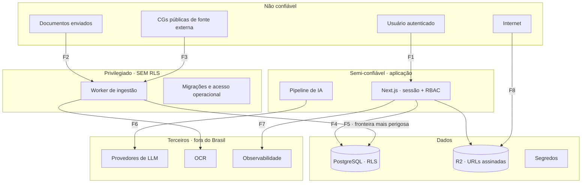

# Análise de Segurança e Threat Model
### Plataforma de Especialistas de IA · Vertical Seguros
**Security Architect · Agosto/2026 · v1.0**

---

## 0. Enquadramento

### 0.1 O que realmente está em jogo

Antes de listar controles, é preciso nomear o que a plataforma guarda:

- **Documentos internos de corretoras concorrentes**, no mesmo banco
- **Procedimentos e conhecimento tácito** — o ativo diferencial de cada cliente
- **Dados pessoais de segurados**, que aparecem em manuais, procedimentos e casos citados
- **O histórico do que foi informado a clientes** — material de defesa jurídica da corretora

### 0.2 O evento terminal

Uma corretora vê documento de outra corretora.

Não é o pior tecnicamente — é o pior **comercialmente**. Corretora vende confiança, opera em
mercado pequeno e altamente conectado, e a notícia circula em uma semana. Um vazamento
cross-tenant não gera churn de um cliente; gera fim do produto.

Isso define a prioridade: **isolamento acima de tudo**, inclusive acima de disponibilidade.

### 0.3 Papéis sob a LGPD — definir isso errado custa caro

| Papel | Quem | Implicação |
|---|---|---|
| **Controlador** | A corretora | Decide finalidade e meios do tratamento dos dados dos segurados |
| **Operador** | A plataforma | Trata em nome do controlador, seguindo suas instruções |
| **Suboperadores** | Provedores de LLM, OCR, hospedagem, observabilidade | Exigem contrato e transparência ao controlador |

**Consequência prática:** o contrato com a corretora precisa ser um contrato de operador,
com lista de suboperadores, e a corretora precisa **saber e concordar** que dados serão
processados fora do Brasil. Descobrir isso na diligência do primeiro cliente grande é o
cenário caro.

### 0.4 A restrição incômoda: não há segregação de funções

Você é desenvolvedor, operador de infraestrutura, DBA e administrador de segurança. Não existe
o controle mais básico de segurança corporativa — duas pessoas diferentes. Isso não se resolve
com ferramenta, e fingir que se resolve é pior que assumir. Tratado em R-15.

---

## 1. Fronteiras de confiança



| Fronteira | Risco principal |
|---|---|
| F1 | Sessão roubada, escalada de privilégio, abuso de API |
| F2 | Upload malicioso, exaustão de recursos |
| F3 | **Injeção via documento de origem não controlada** |
| F4 | Falha de contexto de tenant |
| F5 | **Worker sem RLS — maior probabilidade de vazamento cross-tenant** |
| F6 | Exfiltração via prompt, retenção pelo provedor, transferência internacional |
| F7 | Conteúdo sensível em traços de observabilidade |
| F8 | URL assinada vazada |

---

## 2. Threat Model

Metodologia STRIDE aplicada por fronteira. Classificação = probabilidade × impacto, com peso
extra para o que é irreversível.

### 2.1 Registro de riscos

| ID | Ameaça | STRIDE | Prob. | Impacto | **Classificação** |
|---|---|---|---|---|---|
| **R-01** | Worker vaza dados entre organizações (roda sem RLS) | Divulgação | Média | Terminal | 🔴 **CRITICAL** |
| **R-02** | `SET` sem `LOCAL` vaza contexto de tenant no pool de conexões | Divulgação | Média | Terminal | 🔴 **CRITICAL** |
| **R-03** | Busca vetorial retorna chunks de outra organização por filtro mal aplicado | Divulgação | Baixa | Terminal | 🔴 **CRITICAL** |
| **R-04** | Cache de resposta servido para a organização errada por chave sem escopo | Divulgação | Baixa | Terminal | 🔴 **CRITICAL** |
| **R-05** | Backup exfiltrado — contém **todos** os tenants em claro | Divulgação | Baixa | Terminal | 🔴 **CRITICAL** |
| **R-06** | Injeção via documento induz exfiltração por link/imagem na resposta | Adulteração | Média | Alto | 🔴 **CRITICAL** |
| **R-07** | Credencial do worker ou do banco vaza (repositório, log, variável) | Elevação | Média | Terminal | 🔴 **CRITICAL** |
| **R-08** | "Negação de carteira" — consumo malicioso de IA gera custo insustentável | Negação de serviço | **Alta** | Alto | 🟠 **HIGH** |
| **R-09** | URL assinada vazada dá acesso a documento privado | Divulgação | Média | Alto | 🟠 **HIGH** |
| **R-10** | Upload malicioso explora biblioteca de parsing no worker | Elevação | Média | Alto | 🟠 **HIGH** |
| **R-11** | Escalada horizontal: usuário acessa recurso de outra org por id na URL | Divulgação | Média | Alto | 🟠 **HIGH** |
| **R-12** | Sessão sequestrada (XSS, roubo de cookie) | Falsificação | Baixa | Alto | 🟠 **HIGH** |
| **R-13** | Chave de API vazada em repositório de cliente ou integração | Falsificação | Média | Alto | 🟠 **HIGH** |
| **R-14** | Traços de observabilidade expõem conteúdo de documento e perguntas | Divulgação | Média | Alto | 🟠 **HIGH** |
| **R-15** | **Acesso irrestrito do próprio operador a dados de cliente** | Divulgação | Alta | Alto | 🟠 **HIGH** |
| **R-16** | Dado pessoal de segurado enviado a provedor de IA sem base legal ou salvaguarda | Repúdio | **Alta** | Alto | 🟠 **HIGH** |
| **R-17** | Membro removido mantém sessão ativa | Elevação | Média | Médio | 🟡 **MEDIUM** |
| **R-18** | Jailbreak faz o assistente sair do escopo ou do tom | Adulteração | Alta | **Baixo** | 🟡 **MEDIUM** |
| **R-19** | Bomba de compressão / PDF gigante exaure o worker | Negação de serviço | Média | Médio | 🟡 **MEDIUM** |
| **R-20** | Enumeração de e-mails no fluxo de login ou convite | Divulgação | Alta | Baixo | 🟡 **MEDIUM** |
| **R-21** | Dependência comprometida na cadeia de suprimentos | Adulteração | Baixa | Alto | 🟡 **MEDIUM** |
| **R-22** | Convite reutilizado ou interceptado | Elevação | Baixa | Médio | 🟡 **MEDIUM** |
| **R-23** | Restauração de backup nunca testada falha na hora necessária | Negação de serviço | Média | Alto | 🟡 **MEDIUM** |
| **R-24** | Titular pede exclusão e o dado permanece em backup e traços | Repúdio | Alta | Médio | 🟡 **MEDIUM** |
| **R-25** | Log de aplicação registra pergunta com dado pessoal | Divulgação | Média | Médio | 🟡 **MEDIUM** |
| **R-26** | Auditoria adulterada ou apagada | Repúdio | Baixa | Médio | 🟢 **LOW** |
| **R-27** | Fixação de sessão | Falsificação | Baixa | Médio | 🟢 **LOW** |
| **R-28** | Metadados de arquivo revelam informação da corretora | Divulgação | Baixa | Baixo | 🟢 **LOW** |

### 2.2 Por que R-18 (jailbreak) é apenas MEDIUM

Contraintuitivo, mas correto para esta arquitetura. O pior resultado de um jailbreak
bem-sucedido é **uma resposta fora de tom ou fora de escopo** — não vazamento e não
informação inventada com aparência de verdade.

A razão é estrutural: toda afirmação factual exige citação verificada contra os chunks
efetivamente recuperados, e a recuperação já passou por RLS. Instrução injetada não fabrica
citação válida. O isolamento não depende do prompt.

**Isso só continua verdadeiro enquanto a validação determinística de ancoragem existir.**
Se alguém, por pressão de prazo, trocar a saída estruturada por prosa livre, R-18 sobe
imediatamente para CRITICAL. É a dependência de segurança mais frágil do desenho — e a menos
óbvia.

### 2.3 R-06 em detalhe — a exfiltração que quase todo mundo esquece

O ataque: uma CG baixada de fonte externa contém texto oculto instruindo o modelo a incluir
na resposta um link ou imagem com dados embutidos na URL. Se a interface renderizar markdown
do modelo, o navegador do corretor **faz a requisição sozinho** e entrega o dado ao atacante.
Não exige clique.

Este produto está protegido por acidente feliz de arquitetura: a saída é JSON estruturado com
claims e ids de citação, renderizado por componentes próprios. Não há markdown do modelo
sendo interpretado.

> **Isso precisa virar regra escrita, não sorte.** Nenhuma saída de modelo é renderizada como
> HTML ou markdown. Nenhuma URL vinda do modelo é transformada em link ou imagem. Se um dia
> alguém quiser "deixar a resposta mais bonita" com markdown, esse é o momento em que o furo
> aparece.

---

## 3. Controles por domínio

### 3.1 Multi-tenancy e isolamento — R-01 a R-04, R-11

| Controle | Detalhe |
|---|---|
| RLS em toda tabela com `org_id` | Com `FORCE ROW LEVEL SECURITY` — sem isso o dono da tabela ignora a política |
| `SET LOCAL` dentro de transação, sempre | `SET` sem `LOCAL` em pool de modo transação vaza contexto entre requisições |
| FK composta `(org_id, id)` | Torna cross-tenant fisicamente impossível, mesmo por SQL manual |
| `org_id` sempre da sessão | **Nunca** de parâmetro de requisição, corpo, cabeçalho ou payload de job |
| Worker com `org_id` no payload | E o mesmo `SET LOCAL`. Papel do worker com privilégio mínimo, não superusuário |
| Chave de cache com escopo | `(specialist_id, cache_key)`, nunca busca por `cache_key` isolada |
| Identificadores não sequenciais | UUID em toda URL — enumeração não produz recurso válido |
| Autorização por recurso | Toda leitura por id valida pertencimento, **mesmo com RLS ativa** |

**Teste automatizado obrigatório, critério de aceitação do MVP:**

```
Para cada tabela com org_id, e para cada caminho de acesso
(aplicação, worker, migração, job agendado, busca vetorial, cache):
  com contexto da organização A, tentar alcançar dado da organização B
  → resultado esperado: zero linhas, sempre
```

Este teste roda em cada integração contínua. É o único controle desta lista que, se existir
sozinho, ainda pega a maioria dos vazamentos.

### 3.2 Autenticação e sessão — R-12, R-17, R-20, R-22, R-27

| Controle | Detalhe |
|---|---|
| Cookie de sessão | `httpOnly`, `Secure`, `SameSite=Lax`, sem armazenamento em `localStorage` |
| Rotação de identificador | No login e na troca de privilégio — mata fixação de sessão |
| Expiração | Inatividade de 12h; absoluta de 30 dias |
| Revogação imediata | Remoção ou desativação de membro invalida sessões **naquele momento**, não no próximo login |
| Senhas | Hash com algoritmo de custo de memória; mínimo por comprimento, não por complexidade artificial |
| Resposta uniforme | Login e recuperação de senha respondem igual para e-mail existente e inexistente |
| Convites | Token de alta entropia, armazenado **apenas em hash**, uso único, expiração de 7 dias |
| Segundo fator | Fora do MVP; **obrigatório para papel `owner`** antes do décimo cliente |

> **R-17 merece atenção especial.** Corretor demitido que continua com sessão ativa e acesso
> ao conhecimento interno da corretora é um cenário concreto neste mercado — e é o tipo de
> falha que o cliente descobre e não perdoa. Revogação tem que ser síncrona.

### 3.3 Autorização e RBAC — R-11

Três papéis: `owner`, `admin`, `member`.

| Ação | owner | admin | member |
|---|---|---|---|
| Consultar | ✓ | ✓ | ✓ |
| Ver histórico próprio | ✓ | ✓ | ✓ |
| Ver histórico da organização | ✓ | ✓ | — |
| Enviar e gerenciar documentos | ✓ | ✓ | — |
| Escrever conhecimento interno | ✓ | ✓ | — |
| Publicar especialista | ✓ | ✓ | — |
| Gerenciar usuários | ✓ | ✓ | — |
| Gerenciar chaves de API | ✓ | — | — |
| Plano, cobrança, exclusão da organização | ✓ | — | — |

**Princípios:** negação por padrão; autorização verificada no servidor (controle de interface
é ergonomia, nunca segurança); toda mudança de papel gera registro de auditoria; sempre existe
ao menos um `owner` ativo.

### 3.4 Documentos, storage e URLs — R-09

| Controle | Detalhe |
|---|---|
| Bucket privado | Sem acesso público, sem listagem, sem site estático |
| Chave prefixada por organização | `org/{org_id}/source/{id}/{version}` |
| URL assinada de 5 minutos | Janela curta o suficiente para uso, curta demais para compartilhamento |
| Nome de arquivo aleatório | Nome original só em metadado no banco — nunca na chave do objeto |
| URL nunca em log | Nem em log de acesso, nem em traço, nem em analytics |
| Sem dado sensível em query string | Query string vaza por referrer, histórico e proxy |
| Criptografia em repouso | No provedor de storage e no banco |

> **"URLs públicas" está na sua lista, e a resposta é: no MVP não existem.** A spec de UX
> cortou publicação externa deliberadamente. Vale registrar que essa decisão foi tanto de
> produto quanto de segurança — publicação externa cria sessão anônima, superfície de abuso e
> risco jurídico, e deve entrar com controles próprios, não como "mais uma feature".

### 3.5 Upload malicioso — R-10, R-19

| Vetor | Controle |
|---|---|
| Tipo falsificado por extensão | Validação por assinatura de conteúdo, nunca por extensão ou `Content-Type` |
| PDF com JavaScript embutido | Remoção de conteúdo ativo na ingestão; nunca renderizar PDF original em contexto privilegiado |
| Referências externas / SSRF | Rede do worker **sem saída** exceto para destinos explicitamente permitidos |
| XXE em arquivos de escritório | Parser com entidades externas desabilitadas |
| Bomba de compressão | Limite de tamanho descomprimido e de razão de expansão |
| Arquivo poliglota | Reprocessamento canônico antes de qualquer manipulação |
| Travessia de caminho no nome | Nome do arquivo nunca compõe caminho de disco |
| Exaustão de recursos | Limite de páginas, tempo e memória por job; isolamento por processo |
| Malware servido de volta | Verificação antivírus antes de disponibilizar para download |

**Controle estrutural:** o worker roda em contêiner isolado, com sistema de arquivos
somente-leitura exceto por diretório temporário, sem privilégios elevados, e com rede
restrita. Bibliotecas de parsing de PDF são superfície de vulnerabilidade conhecida — o
isolamento é o que impede que uma falha nelas vire comprometimento do banco.

### 3.6 Injeção via documento e exfiltração — R-06

*Na ingestão:*
- Varredura por padrões imperativos dirigidos a modelo
- Detecção de texto oculto: tamanho zero, cor sobre fundo idêntico, camadas invisíveis
- Chunk suspeito **não é indexado**; documento entra como "Pronto com ressalvas"
- Administrador é informado da página

*Na consulta:*
- Conteúdo recuperado sempre em bloco delimitado, rotulado como dado
- Delimitadores gerados por requisição
- Instrução do sistema jamais concatena conteúdo do usuário ou do documento

*Na saída — a camada que sustenta as outras:*
- **Nenhuma saída de modelo é renderizada como HTML ou markdown**
- **Nenhuma URL vinda do modelo vira link ou imagem**
- Toda afirmação exige citação verificada contra os chunks recuperados
- Claim sem lastro é removido e o estado é rebaixado

### 3.7 Abuso, rate limiting e negação de carteira — R-08

**Este é o risco de maior probabilidade da lista inteira**, e o único onde o dano começa
antes de qualquer intenção maliciosa — um usuário entusiasmado basta.

| Camada | Limite |
|---|---|
| Por usuário | Consultas por minuto e por hora |
| Por organização | Consultas por dia; volume e tamanho de upload |
| Por chave de API | Independente do limite de usuário |
| **Por custo** | **Teto de gasto de IA por organização por dia** |
| Global | Circuit breaker de custo agregado da plataforma |

**O limite por custo é o que falta na maioria dos produtos de IA.** Limitar requisições não
protege: uma consulta com contexto enorme custa dez vezes uma consulta simples. O teto tem que
ser em dinheiro, não em contagem.

**Degradação em vez de bloqueio:** ao atingir o teto, a organização cai para modelo mais
barato e cache antes de ser bloqueada. Cortar o corretor com o cliente na linha destrói a
conta — a resposta ao abuso não pode ser pior que o abuso.

Alerta ao operador em 60% e 85% do teto diário. Um único incidente não detectado pode consumir
a margem do mês.

### 3.8 Segredos — R-07

| Controle | Detalhe |
|---|---|
| Nunca no repositório | Varredura de segredos no fluxo de integração contínua |
| Ambiente cifrado | Segredos apenas em variáveis de ambiente cifradas ou cofre |
| Privilégio mínimo | Credencial da aplicação ≠ credencial do worker ≠ credencial de migração |
| Rotação | Trimestral, e imediata em qualquer suspeita |
| Sem segredo em log | Redação obrigatória; falha de redação é bug de severidade alta |
| Credenciais de integração | Referência a cofre no banco (`credentials_ref`), nunca o valor |

**A credencial mais perigosa do sistema é a do worker**, porque contorna RLS. Ela merece
escopo mais estreito que a da aplicação: acesso apenas às tabelas de conhecimento, sem acesso
a `users`, `invoices` ou `audit_logs`.

### 3.9 Logs, observabilidade e auditoria — R-14, R-25, R-26

**Regra de classificação:**

| Nível | Conteúdo | Destino | Retenção |
|---|---|---|---|
| Log de aplicação | Identificadores, ações, erros. **Nunca** conteúdo de documento ou pergunta | Provedor de logs | 30 dias |
| Traço de IA | Pergunta, contexto recuperado, resposta | Observabilidade de IA | 90 dias |
| Auditoria | Quem fez o quê, quando, em qual objeto | Banco, somente-inserção | 5 anos |

> **O traço de IA é o alvo de maior valor da plataforma inteira** — contém perguntas reais e
> trechos de documento de todos os clientes, juntos. Merece autenticação forte, acesso
> restrito, retenção curta e figura explicitamente na lista de suboperadores comunicada à
> corretora. Tratá-lo como "ferramenta de debug" é subestimar o que ele guarda.

**Auditoria:** `UPDATE` e `DELETE` revogados no nível do banco para o papel da aplicação.
Registra no mínimo: upload, publicação, mudança de permissão, remoção de fonte, geração e
revogação de chave, exportação e acesso administrativo.

### 3.10 LGPD, retenção e exclusão — R-16, R-24

| Obrigação | Implementação |
|---|---|
| Base legal | Execução de contrato com a corretora; dados de segurados tratados sob instrução dela |
| Contrato de operador | Cláusulas de tratamento, lista de suboperadores, notificação de incidente |
| Transferência internacional | Provedores de IA processam fora do Brasil — exige salvaguarda contratual adequada. **Verificar os prazos e o formato de cláusulas-padrão vigentes na ANPD** antes da primeira venda |
| Retenção sem treinamento | Contratar modo sem retenção e opt-out de treinamento com todo provedor de IA |
| Direitos do titular | Titular é do segurado; pedido chega pela corretora. Prazo e fluxo definidos em contrato |
| Retenção | Documentos: vida da conta + 30 dias · Consultas: 5 anos · Traços: 90 dias · Logs: 30 dias |
| Exclusão | Purga real em storage e banco em até 30 dias; anonimização de usuários sem outro vínculo |
| Incidente | Procedimento escrito de comunicação à ANPD e aos titulares |

**R-24 merece honestidade técnica:** dado excluído continua em backup até o backup expirar.
Isso é aceito e documentado — a política declara a janela e o backup não é usado para
restaurar dados de titular que pediu exclusão. Prometer exclusão instantânea em backup é
promessa que não se cumpre.

**R-16 é o risco de LGPD mais provável**, porque não depende de ataque: basta um manual
interno com nome e CPF de segurado ser enviado e recuperado numa consulta. Mitigação:
detecção de dado pessoal na ingestão, com aviso ao administrador, e política de não repetir
dado pessoal na resposta quando não for necessário.

### 3.11 Backups e criptografia — R-05, R-23

| Controle | Detalhe |
|---|---|
| Backup contínuo | Recuperação a qualquer ponto no tempo; RTO alvo de 1 hora |
| Criptografia | Em repouso e em trânsito, com chave gerenciada pelo provedor |
| Acesso ao backup | Credencial separada da de produção |
| **Teste de restauração** | **Trimestral, obrigatório** — backup nunca testado é backup inexistente |
| Retenção | 30 dias |

> **R-05 é CRITICAL e frequentemente subestimado.** O backup contém todos os tenants em um
> único artefato — é o objeto de maior concentração de risco da plataforma. Um vazamento ali
> é pior que um bug de RLS, porque não vaza uma consulta, vaza tudo.

### 3.12 Chaves de API — R-13

Armazenadas apenas em hash, com prefixo visível para localização. Escopo por organização e por
capacidade. Expiração opcional, revogação imediata, registro de último uso. Exibidas uma única
vez na criação. Alerta ao `owner` em criação e revogação.

Quando a API pública existir: limites independentes dos de usuário e detecção de uso anômalo
(pico súbito, origem geográfica nova).

### 3.13 Cadeia de suprimentos — R-21

Fixação de versões, verificação automática de vulnerabilidades, revisão de dependência nova
antes de adotar, e — o mais relevante para um projeto solo — **preferência deliberada por
menos dependências**. Cada biblioteca é superfície de ataque que você não escreveu e não
audita.

### 3.14 Risco do operador — R-15

O único risco desta lista que não tem solução técnica completa.

| Mitigação | Detalhe |
|---|---|
| Acesso operacional registrado | Consulta administrativa a dado de cliente gera registro de auditoria |
| Visões anonimizadas | Diagnóstico usa visão sem conteúdo de documento, por padrão |
| Acesso de emergência declarado | Procedimento explícito, com registro e justificativa |
| Transparência contratual | O contrato declara que existe acesso operacional e em que condições |
| Ambientes separados | Desenvolvimento **nunca** usa dados reais de cliente |

O último item é o mais violado por quem trabalha sozinho, e o mais fácil de justificar no
momento ("só para testar uma coisa"). Vale escrever a regra agora, antes de existir a
tentação com cliente real dentro.

---

## 4. Prioridade de implementação

Uma lista de 60 controles é inútil para uma pessoa. Esta é a ordem que eu seguiria.

### Antes do primeiro cliente — inegociáveis

1. RLS com `FORCE` em toda tabela + `SET LOCAL` em transação
2. FK composta `(org_id, id)`
3. **Teste automatizado de isolamento cross-tenant, incluindo caminhos do worker**
4. Worker isolado, com privilégio e rede mínimos
5. Chave de cache com escopo de especialista
6. Nenhuma saída de modelo renderizada como markdown ou HTML
7. Teto de custo de IA por organização, com alerta
8. Segredos fora do repositório, com varredura na integração contínua
9. Classificação de log: conteúdo nunca em log de aplicação
10. Contrato de operador e lista de suboperadores prontos

### Antes do décimo cliente

11. Segundo fator obrigatório para `owner`
12. Teste de restauração de backup executado ao menos uma vez
13. Sanitização completa de upload e antivírus
14. Detecção de injeção na ingestão
15. Revogação síncrona de sessão
16. Auditoria somente-inserção, com revogação no banco
17. Rotina de purga e exclusão funcionando de fato
18. Procedimento escrito de resposta a incidente

### Antes de escalar ou de captar

19. Teste de intrusão externo
20. Detecção de anomalia de uso
21. Segundo fator para todos
22. Registro de suboperadores mantido e comunicado
23. Revisão formal de acesso operacional

---

## 5. O que eu vigiaria toda semana

Cinco sinais. Se algum se mover, é investigação imediata, não item de backlog:

1. Qualquer resultado não-zero no teste de isolamento cross-tenant
2. Custo de IA por organização acima da mediana histórica
3. Chunks marcados como suspeitos na ingestão
4. Taxa de claims removidos na validação de ancoragem *(subida indica injeção ou regressão do modelo)*
5. Acessos administrativos a dados de cliente

---

## 6. A dependência frágil que vale repetir

Toda a postura de segurança contra manipulação de IA — R-06 e R-18 — repousa em **duas**
decisões de arquitetura:

1. Saída estruturada com claims e ids de citação verificáveis
2. Nenhuma renderização de markdown ou HTML vindo do modelo

Se alguma das duas cair por conveniência de produto — "vamos deixar a resposta com formatação
mais rica" —, dois riscos sobem de MEDIUM/CRITICAL-mitigado para CRITICAL-ativo no mesmo
commit, e provavelmente ninguém vai perceber a relação.

Isso merece um comentário no código e uma linha na revisão de qualquer mudança de renderização.

---

**Próximo passo sugerido:** escrever o teste de isolamento cross-tenant como especificação
executável, antes de qualquer código de aplicação. É o único controle desta lista que, se
existir sozinho, ainda pega a maioria dos vazamentos — e é muito mais barato escrevê-lo antes
do esquema existir do que depois.
